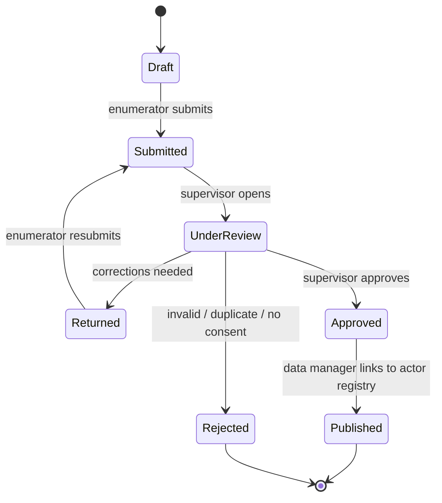
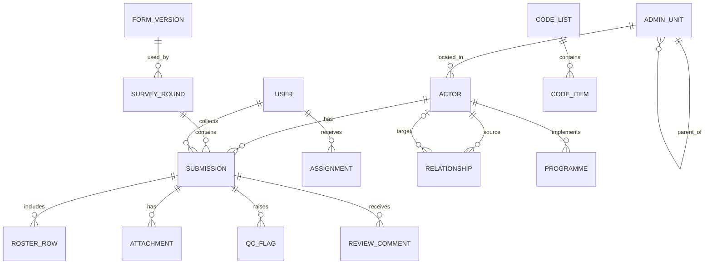

# Business Requirements Document (BRD)
## Multi-Actor and Multi-Level Mapping System for the Agriculture and Fisheries Sector – Maputo Province

| Item | Value |
|---|---|
| Document | Business Requirements Document – web application for the multi-actor mapping survey |
| Client / data owner | Direcção Provincial de Agricultura e Pescas de Maputo (DPAP) – Provincial Directorate of Agriculture and Fisheries |
| Project | EXP.2020DEA003 – *Promoção do desenvolvimento tecnológico agrário e pesqueiro sustentável na Província de Maputo no quadro da localização dos ODS* |
| Activity | R1.A2 – Database for the multi-actor and multi-level mapping of the agriculture and fisheries sector |
| Funder | Agência Andaluza de Cooperación Internacional para el Desarrollo (AACID) |
| Source instrument | *Questionário de Mapeamento Multi-actor e Multi-nível*, v1.0 (Portuguese, 16 modules 0–O) |
| Version / date | 1.0 – 29 October 2026 |
| Intended audience | Developers (incl. Claude Code), DPAP IT, consultant team, DPAP focal points |

> **How to use this document with Claude Code.** Section 7 (Field Catalogue) is the authoritative specification of every field. The first implementation task should be to convert Section 7 into a machine-readable form schema (`form_schema.json`) from which the database migrations, the data-entry UI, validation and exports are generated. Do **not** hard-code questions in UI components. Requirement IDs (FR-xxx, NFR-xxx, BR-xxx) must be referenced in commit messages, tests and issues. Section 14 gives a recommended build order.

---

## Table of contents
1. Introduction
2. Business objectives and scope
3. Stakeholders and user roles
4. Business processes and workflow
5. Functional requirements
6. Data requirements and data model
7. Field catalogue (questionnaire specification)
8. Business and validation rules
9. Reporting, indicators and dashboards
10. Non-functional requirements
11. Recommended architecture (non-binding)
12. Deliverables, milestones and acceptance criteria
13. Assumptions, constraints and open issues
14. Implementation guidance for Claude Code
15. Traceability matrix (ToR → system)
- Appendix A – Code lists
- Appendix B – Glossary

---

## 1. Introduction

### 1.1 Purpose
This document translates the approved survey questionnaire and the Terms of Reference (ToR) of activity R1.A2 into business requirements for a web-based information system. The system must (a) support field data collection with the questionnaire, (b) store the results as a **digital, georeferenced database of sector actors** installed and operational at DPAP, and (c) allow DPAP to analyse, update and reuse the data in future survey rounds.

### 1.2 Background
Under the AACID–Maputo Provincial Government partnership, DPAP needs to know who intervenes in the agriculture, livestock, fisheries and aquaculture value chains, at what administrative level, and how they relate to each other and to government planning. The ToR require a census of public and private, national and foreign actors; their classification by level of operation; identification of technologies used; and a georeferenced database handed over to DPAP with source code, installation files, admin credentials, a full open-format data copy, technical documentation and manuals in Portuguese, and staff training.

### 1.3 Target population (actor types)
| Code | Actor type (EN) | UI label (PT) |
|---|---|---|
| 1 | Individual producer (farmer, livestock keeper, fisher, fish farmer) | Produtor individual |
| 2 | Association, cooperative or producer group | Associação, cooperativa ou grupo de produtores |
| 3 | Organisation (NGO, CSO, cooperation agency, research or education institution) | Organização |
| 4 | Company or private operator along the value chain | Empresa ou operador privado |
| 5 | Public institution with sector competences (provincial, district, administrative post, locality) | Instituição pública |

### 1.4 Geographic coverage
All districts of Maputo Province (Boane, Magude, Manhiça, Marracuene, Matola, Matutuíne, Moamba, Namaacha), down to Administrative Post, Locality and Village (Povoado/Bairro).

---

## 2. Business objectives and scope

### 2.1 Business objectives
| ID | Objective | Success measure |
|---|---|---|
| BO-1 | Census all public/private, national/foreign actors in the sector | Every interviewed actor exists once in the Actor Registry with a unique ID |
| BO-2 | Classify actors by level of operation | 100 % of approved records have A.17 and A.18 populated |
| BO-3 | Identify technologies used in production | Module G completed for all applicable actors; technology adoption report available |
| BO-4 | Build a georeferenced database installed and operational at DPAP | ≥ 95 % of approved records with valid GPS inside the province; system running on DPAP infrastructure |
| BO-5 | Map multi-actor relationships to assign responsibilities per level | Network view built from N.03, J.13 and programme rosters |
| BO-6 | Enable future updates (longitudinal use) | New survey rounds and record updates possible without developer intervention |

### 2.2 In scope
- Form engine rendering the questionnaire (Portuguese UI) with skip logic, validation, rosters and versioning.
- Offline-capable data collection on Android tablets/phones and laptops (browser/PWA).
- Fieldwork management: assignments, progress monitoring, supervisor review and QC.
- Actor Registry (master data) with de-duplication, history and updates.
- GIS map, network (relationship) view, dashboards and standard reports for the ToR indicators.
- Data export in open formats, full database dump, data dictionary export.
- Administration: users/roles, code lists, administrative units, form versions, audit log, backup/restore.
- Technical documentation, user and administrator manuals (Portuguese), training support.

### 2.3 Out of scope (current phase)
- Integration with national systems (e.g. national agricultural statistics or licensing systems) – design APIs to allow it later (FR-EXP-6).
- Payments, SMS campaigns, public self-registration portal (possible phase 2).
- Native iOS application.

---

## 3. Stakeholders and user roles

### 3.1 Stakeholders
| Stakeholder | Interest |
|---|---|
| DPAP management | Planning, coordination, allocation of responsibilities per actor and level |
| DPAP focal points (1–2) | Day-to-day counterpart, data validation, future administration |
| SDAE (District Economic Activities Services) | District-level use of data and future updates |
| Consultant team (enumerators, supervisors, data manager) | Data collection and quality |
| AACID | Project results and reporting |
| Partners (NGOs, cooperation agencies, companies) | Access to non-sensitive aggregated data |

### 3.2 User roles
| Role | Description |
|---|---|
| **System Administrator** | DPAP IT. Full technical control: users, roles, backups, configuration, form versions. |
| **Data Manager** | Consultant/DPAP. Manages code lists, assignments, final validation, de-duplication, publication, exports. |
| **Supervisor** | Reviews, comments, approves or returns submissions of assigned enumerators/districts. |
| **Enumerator** | Collects data (offline/online), edits own drafts and returned submissions only. |
| **Analyst (DPAP / SDAE)** | Read access to approved data, dashboards, map, network, exports (scoped by district for SDAE). |
| **Partner Viewer** | Read-only aggregated dashboards and map; personal contacts hidden unless A.23 = 1. |

### 3.3 Permissions matrix
| Capability | Sys Admin | Data Mgr | Supervisor | Enumerator | Analyst | Partner |
|---|---|---|---|---|---|---|
| Manage users & roles | ✔ | – | – | – | – | – |
| Manage form versions / code lists / admin units | ✔ | ✔ | – | – | – | – |
| Create assignments | ✔ | ✔ | ✔ (own team) | – | – | – |
| Collect / edit own drafts | – | ✔ | ✔ | ✔ | – | – |
| Review / approve / return | ✔ | ✔ | ✔ (own team) | – | – | – |
| Merge duplicates / publish to registry | ✔ | ✔ | – | – | – | – |
| View approved microdata incl. contacts | ✔ | ✔ | ✔ (own team) | own only | ✔ (scoped) | – |
| View contacts where A.23 = 2 | ✔ | ✔ | ✔ | own only | – | – |
| Dashboards, map, network | ✔ | ✔ | ✔ | – | ✔ | aggregated only |
| Export microdata | ✔ | ✔ | – | – | ✔ (scoped, anonymised option) | – |
| Audit log, backups | ✔ | read | – | – | – | – |

---

## 4. Business processes and workflow

### 4.1 End-to-end process
1. **Preparation** – Data Manager loads administrative units and code lists, publishes form version, creates users and assignments (by district / administrative post / actor type). The database structure and forms **must be presented to and validated by DPAP before fieldwork starts** (ToR §4) – the system must support a "validation/pilot" mode.
2. **Collection** – Enumerator downloads assignments and form to the device, interviews actor (offline possible), captures GPS and photo, saves and submits.
3. **Synchronisation** – Device syncs when connectivity is available; server runs automated QC checks.
4. **Review** – Supervisor reviews flagged and random submissions, adds field-level comments, approves or returns to enumerator.
5. **Validation & registry** – Data Manager resolves duplicates, links submission to an existing Actor or creates a new Actor, publishes to the Actor Registry.
6. **Analysis & reporting** – Dashboards, maps, network and ToR reports (preliminary, mid-term and final presentations at DPAP).
7. **Maintenance & future rounds** – DPAP updates actor records, launches new survey rounds with new form versions; history is preserved.

### 4.2 Submission status lifecycle

### 4.3 Module routing
Routing is driven by **0.12 (consent)**, **0.13 (actor type)** and **A.15 (subsectors)**. ● mandatory, ○ conditional on A.15.

| Module | 1 Producer | 2 Association | 3 Organisation | 4 Company | 5 Public inst. |
|---|---|---|---|---|---|
| 0 – Interview identification and control | ● | ● | ● | ● | ● |
| A – Actor identification and general profile | ● | ● | ● | ● | ● |
| B – Individual producer and household | ● | – | – | – | – |
| C – Crop production | ○ | ○ | – | ○ | – |
| D – Livestock production and animal health | ○ | ○ | – | ○ | – |
| E – Fisheries | ○ | ○ | – | ○ | – |
| F – Aquaculture | ○ | ○ | – | ○ | – |
| G – Technologies used in production | ● | ● | ○ | ● | ○ |
| H – Marketing and sales | ● | ● | – | ● | – |
| I – Financing | ● | ● | ● | ● | – |
| J – Associations, cooperatives and producer groups | – | ● | – | – | – |
| K – National and foreign organisations | – | – | ● | – | – |
| L – Companies and private operators | – | – | – | ● | – |
| M – Public institutions | – | – | – | – | ● |
| N – Multi-actor linkages and coordination with government | ● | ● | ● | ● | ● |
| O – Closing and quality control | ● | ● | ● | ● | ● |

If 0.12 = 2 (no consent) the interview jumps to 0.15 and ends; only module 0 is stored.

---

## 5. Functional requirements
Priority: **M** = Must, **S** = Should, **C** = Could (MoSCoW).

### 5.1 Authentication and user management (AUTH)
| ID | Requirement | Pri. |
|---|---|---|
| FR-AUTH-1 | Users log in with username/e-mail and password; passwords hashed (Argon2/bcrypt); password policy configurable. | M |
| FR-AUTH-2 | Role-based access control per Section 3.3, with optional geographic scope (district list) per user. | M |
| FR-AUTH-3 | Offline login on device for previously authenticated enumerators (cached credential token with expiry, default 14 days). | M |
| FR-AUTH-4 | Password reset by administrator; self-service reset by e-mail when SMTP is configured. | S |
| FR-AUTH-5 | Session timeout (configurable, default 30 min idle on web back-office). | M |
| FR-AUTH-6 | Optional two-factor authentication for Sys Admin and Data Manager. | C |

### 5.2 Form engine (FORM)
| ID | Requirement | Pri. |
|---|---|---|
| FR-FORM-1 | The questionnaire is defined by a versioned JSON schema (modules, fields, types, code lists, relevance, constraints, rosters, labels). UI, validation, DB and exports are generated from it. | M |
| FR-FORM-2 | Support all field types of Section 7: text, integer, decimal, select_one, select_multiple, yes_no, date, time, geopoint, phone, e-mail, image, fixed rosters and repeatable rosters. | M |
| FR-FORM-3 | Evaluate relevance (skip logic) in real time on the client; hidden fields are cleared and stored as `-1` (not applicable). | M |
| FR-FORM-4 | Evaluate constraints on the client (blocking errors vs. warnings) and re-validate on the server. | M |
| FR-FORM-5 | "Other (specify)" (code 96) automatically shows a mandatory text field `<var>_other`. | M |
| FR-FORM-6 | Special codes 98 (don't know) and 99 (refused) available for every required field via a "Não sabe / Não respondeu" action. | M |
| FR-FORM-7 | Module-by-module navigation with progress bar, section completeness indicators and jump-to-module. | M |
| FR-FORM-8 | Auto-calculated fields (roster totals, duration = 0.14 − 0.03) displayed read-only. | M |
| FR-FORM-9 | Labels in Portuguese (pt-MZ) by default; schema supports additional languages (English, local languages) per label key. | M |
| FR-FORM-10 | Form versioning: each submission stores `form_version`; old versions remain readable; data dictionary per version. | M |
| FR-FORM-11 | Form designer UI for Data Manager to edit labels, add options to code lists and add new fields without code changes (structural changes create a new version). | S |
| FR-FORM-12 | Export the form to XLSForm (ODK/KoboToolbox-compatible) and import XLSForm submissions (CSV) as a fallback channel. | C |
| FR-FORM-13 | Printable PDF of the questionnaire and of a single completed submission. | S |

### 5.3 Offline data collection (MOB)
| ID | Requirement | Pri. |
|---|---|---|
| FR-MOB-1 | Data entry works fully offline on Android 9+ tablets/phones (PWA installable, or wrapped app) and on desktop browsers. | M |
| FR-MOB-2 | Assignments, form schema, code lists and admin units are cached on the device. | M |
| FR-MOB-3 | Auto-save every field change locally (IndexedDB/SQLite); no data loss on app close, crash or battery loss. | M |
| FR-MOB-4 | Capture GPS (0.10) with live accuracy display; block saving the point until accuracy ≤ 10 m or the enumerator records a reason for lower accuracy; store lat, lon, altitude, accuracy, timestamp. | M |
| FR-MOB-5 | Capture photo (0.11) from camera; compress on device (≤ 2 MB); attach to submission. | M |
| FR-MOB-6 | Manual and automatic background sync with retry, resumable uploads and a visible sync status per submission. | M |
| FR-MOB-7 | Record device metadata (device ID, app version, start/end timestamps, GPS at start). | M |
| FR-MOB-8 | Enumerator sees list of own submissions with status and supervisor comments; can correct "Returned" items offline. | M |
| FR-MOB-9 | Duplicate warning on device when an actor with similar name/phone/NUIT exists in the cached registry for the same district. | S |
| FR-MOB-10 | Offline base map tiles for assigned district(s). | C |

### 5.4 Fieldwork management (FLD)
| ID | Requirement | Pri. |
|---|---|---|
| FR-FLD-1 | Create assignments (enumerator × district/admin post/locality × actor type × target count). | M |
| FR-FLD-2 | Pre-load known actors (e.g. lists of associations, NGOs, companies from DPAP/SDAE) as "expected" records to be visited. | S |
| FR-FLD-3 | Progress dashboard: submissions per enumerator, district, actor type and status vs. targets; map of today's interviews. | M |
| FR-FLD-4 | Productivity and paradata: interview duration, interviews/day, time between interviews. | S |

### 5.5 Review and quality control (QC)
| ID | Requirement | Pri. |
|---|---|---|
| FR-QC-1 | Automated QC checks on every submission (see BR-QC rules, Section 8.3); flags stored with severity. | M |
| FR-QC-2 | Review screen shows the full submission by module, QC flags, GPS on map and photo. | M |
| FR-QC-3 | Field-level comments; actions Approve / Return / Reject with mandatory reason for Return/Reject. | M |
| FR-QC-4 | Edits by reviewers are tracked (old value, new value, user, timestamp, reason). | M |
| FR-QC-5 | Back-check sampling: system proposes a random % (configurable, default 10 %) of approved submissions for re-visit/phone verification and records the result. | S |

### 5.6 Actor Registry (REG)
| ID | Requirement | Pri. |
|---|---|---|
| FR-REG-1 | Maintain one master **Actor** record per real-world actor with a permanent ID (`actor_uid`, e.g. `MPT-<district>-<seq>`), independent of the submission ID (0.01). | M |
| FR-REG-2 | A submission is linked to an Actor on publication; an Actor may have many submissions over time (survey rounds / updates). | M |
| FR-REG-3 | Current-state view of an Actor = latest approved values; full history and comparison between rounds available. | M |
| FR-REG-4 | Duplicate detection (fuzzy name, phone, NUIT, GPS within 200 m, same actor type) and a merge tool that keeps the audit trail. | M |
| FR-REG-5 | Search and filter actors by any categorical field: actor type, district, level, subsector, value-chain link, legal status, sex of respondent, species, technology, etc. | M |
| FR-REG-6 | Actor profile page: identification, contacts (subject to privacy rules), map location, modules summary, programmes, relationships, history, attachments. | M |
| FR-REG-7 | Direct edit of master data by Data Manager/Analyst with permission, with reason and audit. | S |
| FR-REG-8 | Hierarchical links: association ↔ member producers (B.07), organisation/company ↔ programmes, institution ↔ parent institution (M.03). | S |

### 5.7 GIS and mapping (GIS)
| ID | Requirement | Pri. |
|---|---|---|
| FR-GIS-1 | Interactive web map of actors with clustering, symbology by actor type and colour by subsector. | M |
| FR-GIS-2 | Administrative boundary layers (province, districts, admin posts, localities when available) with choropleth of counts/indicators. | M |
| FR-GIS-3 | Filters identical to registry filters; click on point opens actor profile. | M |
| FR-GIS-4 | Infrastructure layer from D.03 / landing sites (E.03) where coordinates exist. | C |
| FR-GIS-5 | Export filtered data as GeoJSON, KML and Shapefile (zipped); WMS/WFS is optional. | S |

### 5.8 Multi-actor network (NET)
| ID | Requirement | Pri. |
|---|---|---|
| FR-NET-1 | Build a relationship graph from roster N.03 (relationships), J.13 (association partners) and programme rosters (K.08, L.11, M.07 → districts). | M |
| FR-NET-2 | Data Manager links free-text partner names to registered Actors (suggestions by fuzzy match); unmatched partners remain "unregistered nodes". | M |
| FR-NET-3 | Interactive network visualisation filterable by relationship type, level, district and actor type; node size by degree. | M |
| FR-NET-4 | Multi-level view: actors grouped by level of operation (A.17) – provincial / district / admin post / locality – showing who intervenes where. | M |
| FR-NET-5 | Basic metrics per actor: degree, in/out links, most connected actors, isolated actors; export edge list (CSV). | S |

### 5.9 Dashboards and reports (RPT)
| ID | Requirement | Pri. |
|---|---|---|
| FR-RPT-1 | Standard dashboards for all indicators of Section 9, filterable by district, actor type, level and period/round. | M |
| FR-RPT-2 | Sex- and age-disaggregated figures wherever the data allow (A.05, A.22, B.02, J.06, K.07, M.05, beneficiaries). | M |
| FR-RPT-3 | Generate the ToR report tables (Section 15) as XLSX/PDF for preliminary, mid-term and final presentations. | M |
| FR-RPT-4 | Custom table builder (pivot: rows/columns/measure) for analysts. | S |
| FR-RPT-5 | Charts downloadable as PNG; tables as XLSX/CSV. | S |

### 5.10 Exports and open data (EXP)
| ID | Requirement | Pri. |
|---|---|---|
| FR-EXP-1 | Export microdata (approved) as CSV/XLSX: one main file per submission + one file per roster, keyed by `q0_01` and `actor_uid`; codes and/or labels selectable. | M |
| FR-EXP-2 | Export to SPSS/Stata/R-friendly formats with value labels (CSV + syntax files acceptable). | S |
| FR-EXP-3 | Export the data dictionary (Section 7) per form version as XLSX/CSV/JSON. | M |
| FR-EXP-4 | Full database backup/dump in open format (PostgreSQL SQL dump + CSV bundle + attachments) for DPAP ownership (ToR §5). | M |
| FR-EXP-5 | Anonymised export option removing names, phones, e-mails, NUIT, photos and jittering GPS for individual producers. | M |
| FR-EXP-6 | Documented REST API (OpenAPI 3) for read access to approved data, with API keys per client. | S |

### 5.11 Administration (ADM)
| ID | Requirement | Pri. |
|---|---|---|
| FR-ADM-1 | Manage administrative unit hierarchy (Province → District → Administrative Post → Locality → Village) with codes and optional boundaries (GeoJSON upload). | M |
| FR-ADM-2 | Manage code lists (add/deactivate options, never delete used codes). | M |
| FR-ADM-3 | Manage survey rounds (e.g. "Baseline 2026", "Update 2028") linked to form versions. | M |
| FR-ADM-4 | Audit log of logins, data changes, exports and configuration changes, searchable and exportable. | M |
| FR-ADM-5 | Scheduled automatic backups (daily, retention configurable) and documented restore procedure tested at handover. | M |
| FR-ADM-6 | System settings: organisation name/logos, SMTP, GPS accuracy threshold, QC thresholds, session timeout. | S |

### 5.12 Privacy and data protection (PRV)
| ID | Requirement | Pri. |
|---|---|---|
| FR-PRV-1 | Consent (0.12) is mandatory; without consent only module 0 is stored. | M |
| FR-PRV-2 | If A.23 = 2, contact fields (A.09–A.13, A.08) are visible only to Sys Admin, Data Manager, Supervisor and the collecting enumerator, and excluded from partner/analyst views and default exports. | M |
| FR-PRV-3 | Personal data of individual producers never shown on partner-level maps at exact location (aggregate or jitter ≥ 1 km). | M |
| FR-PRV-4 | Data encrypted in transit (TLS 1.2+) and at rest on devices (encrypted local store) where platform allows. | M |
| FR-PRV-5 | Right to correction/removal: Data Manager can anonymise an actor on request, logged in audit. | S |

### 5.13 Documentation and training (DOC)
| ID | Requirement | Pri. |
|---|---|---|
| FR-DOC-1 | Technical documentation: architecture, data model (ERD), data dictionary, API, deployment and backup/restore (Portuguese; English acceptable for code-level docs). | M |
| FR-DOC-2 | User manual (enumerator, supervisor, analyst) and Administrator manual in **Portuguese**. | M |
| FR-DOC-3 | Source code repository, installation files/scripts, admin credentials and full data copy handed over to DPAP; DPAP owns all IP and data. | M |
| FR-DOC-4 | Training materials and a training session report for DPAP technicians (use and administration). | M |

---

## 6. Data requirements and data model

### 6.1 Core entities
| Entity | Description | Key attributes |
|---|---|---|
| `admin_unit` | Hierarchical administrative units | id, code, name, level (province/district/post/locality/village), parent_id, geometry |
| `code_list` / `code_item` | Reference lists (Appendix A and all field options) | list_name, code, label_pt, label_en, active, order |
| `form_version` | Versioned questionnaire schema | id, version, schema_json, status, published_at |
| `survey_round` | Data collection campaign | id, name, start/end, form_version_id |
| `user`, `role`, `user_scope` | Accounts, roles, district scope | |
| `assignment` | Work allocation | enumerator_id, admin_unit_id, actor_type, target |
| `actor` | Master record per real actor (registry) | actor_uid, actor_type, name, district, current GPS (PostGIS point), status, created/updated |
| `submission` | One interview (questionnaire instance) | id = q0_01, actor_id (nullable until published), round_id, form_version, status, enumerator_id, supervisor_id, all scalar fields (or JSONB + typed columns), gps, timestamps, device_id |
| `roster_*` | One table per roster (Section 7, e.g. `roster_d_01_herd`) | id, submission_id, row_code / row_index, columns |
| `relationship` | Network edge derived from N.03/J.13 | source_actor_id, target_actor_id (nullable), target_name, relation_types[], frequency, rating, origin_field |
| `programme` | Programmes/projects (K.08, L.11, M.07) | actor_id, name, thematic_area, districts[], beneficiaries_m/f, funding, budget, start, end |
| `attachment` | Photos and files | submission_id, field, file_path, mime, size, checksum |
| `qc_flag` | QC results | submission_id, rule_id, severity, message, resolved_by |
| `review_comment` | Field-level review comments | submission_id, field, comment, author, status |
| `audit_log` | Immutable change log | user, action, entity, entity_id, before, after, timestamp, ip |

### 6.2 Conceptual ERD

### 6.3 Data conventions
- **Variable names:** `q<Module>_<No>` (e.g. `qA_15`) as stable keys; snake_case `field name` used in API/JSON. Roster columns: `q<Module>_<No>_c<n>` / column name.
- **select_multiple** stored as an array of integer codes (PostgreSQL `integer[]` or join table) and exported as space-separated codes plus one 0/1 dummy column per option.
- **Special codes:** `96` Other (with `_other` text), `98` Don't know, `99` Refused, `-1` Not applicable (set by relevance).
- **Coordinates:** WGS84 (EPSG:4326), decimal degrees, 6 decimals; stored as PostGIS `geography(Point)` + accuracy.
- **Dates/times:** ISO 8601; server stores UTC, UI displays Africa/Maputo (UTC+2).
- **Currency:** Mozambican Metical (MZN, labelled “MT” in UI) unless stated (USD for K.08 budget).
- **Labels:** Portuguese labels in Section 7 are the canonical UI strings and must be used verbatim.

---

## 7. Field catalogue (questionnaire specification)

**Column legend.** *Variable* = stable key. *Req.*: Y = required when the module is relevant; C = conditional (required only when its relevance condition is true); N = optional. *Relevance/skip* uses question IDs; "skip to" means fields in between become not applicable (`-1`). Option codes are shown with their Portuguese UI labels; code `96` always triggers a free-text “especificar” field.

### Module 0 – Interview identification and control

- **Portuguese title (UI):** Identificação e controlo da entrevista
- **Applies to:** All actors
- **Module relevance expression:** `always`
- **Storage:** scalar fields in `submission` (or a module table `interview`); rosters in child tables listed below.

| ID | Variable | Field name | Label (EN) | UI label (PT) | Type | Req. | Relevance / skip | Options (code = PT label) | Validation |
|---|---|---|---|---|---|---|---|---|---|
| 0.01 | `q0_01` | `questionnaire_number` | Questionnaire number (system-generated) | Número do questionário | integer | Y |  | unit: (gerado automaticamente) | integer ≥ 0, max 6 digits; primary key, unique, auto-generated |
| 0.02 | `q0_02` | `interview_date` | Interview date | Data da entrevista | date | Y |  |  | valid date ≤ today |
| 0.03 | `q0_03` | `start_time` | Start time | Hora de início | time | Y |  |  |  |
| 0.04 | `q0_04` | `enumerator` | Enumerator name and code | Nome e código do inquiridor | text | Y |  |  | max 255 chars |
| 0.05 | `q0_05` | `supervisor` | Supervisor name | Nome do supervisor | text | Y |  |  | max 255 chars |
| 0.06 | `q0_06` | `district` | District | Distrito | select_one | Y |  | 1=Boane; 2=Magude; 3=Manhiça; 4=Marracuene; 5=Matola; 6=Matutuíne; 7=Moamba; 8=Namaacha |  |
| 0.07 | `q0_07` | `admin_post` | Administrative Post | Posto Administrativo | text | Y |  |  | max 255 chars |
| 0.08 | `q0_08` | `locality` | Locality | Localidade | text | Y |  |  | max 255 chars |
| 0.09 | `q0_09` | `village` | Village / neighbourhood (Povoado / Bairro) | Povoado / Bairro | text | Y |  |  | max 255 chars |
| 0.10 | `q0_10` | `gps` | Actor geographic coordinates (WGS84, decimal degrees) | Coordenadas geográficas do actor (WGS84, graus decimais) | geopoint | Y |  |  | lat/lon/alt/accuracy; accuracy ≤ 10 m (warn), must fall inside Maputo Province polygon (hard warning) |
| 0.11 | `q0_11` | `photo` | Photo of headquarters / farm / boat | Fotografia da sede / exploração / embarcação | image | N |  |  | JPEG, max 2 MB after client-side compression |
| 0.12 | `q0_12` | `consent` | Respondent agrees to participate after the consent statement is read | O respondente aceita participar no inquérito, após leitura da declaração de consentimento? | select_one | Y | If = 2 → skip to 0.15 | 1=Sim; 2=Não |  |
| 0.13 | `q0_13` | `actor_type` | Actor type (drives module routing) | Tipo de actor | select_one | Y |  | 1=Produtor individual (agricultor, criador, pescador, aquacultor); 2=Associação, cooperativa ou grupo de produtores; 3=Organização (ONG, OSC, agência de cooperação, instituição de investigação ou ensino); 4=Empresa ou operador privado; 5=Instituição pública |  |
| 0.14 | `q0_14` | `end_time` | End time | Hora de fim | time | Y |  |  | > q0_03 |
| 0.15 | `q0_15` | `interview_result` | Interview result | Resultado da entrevista | select_one | Y |  | 1=Completa; 2=Parcial; 3=Recusa; 4=Respondente ausente; 96=Outro (+text) |  |

### Module A – Actor identification and general profile

- **Portuguese title (UI):** Identificação e caracterização geral do actor
- **Applies to:** All actors
- **Module relevance expression:** `q0_12 = 1`
- **Storage:** scalar fields in `submission` (or a module table `actor`); rosters in child tables listed below.

| ID | Variable | Field name | Label (EN) | UI label (PT) | Type | Req. | Relevance / skip | Options (code = PT label) | Validation |
|---|---|---|---|---|---|---|---|---|---|
| A.01 | `qA_01` | `actor_name` | Full name of actor / entity | Nome completo do actor / designação da entidade | text | Y |  |  | max 255 chars |
| A.02 | `qA_02` | `acronym` | Acronym or trading name | Sigla ou nome comercial | text | N |  |  | max 255 chars |
| A.03 | `qA_03` | `respondent_name` | Respondent name | Nome do respondente | text | Y |  |  | max 255 chars |
| A.04 | `qA_04` | `respondent_position` | Respondent position / role | Cargo / função do respondente | text | C | If 0.13 ≠ 1 |  | max 255 chars |
| A.05 | `qA_05` | `respondent_sex` | Respondent sex | Sexo do respondente | select_one | Y |  | 1=Masculino; 2=Feminino |  |
| A.06 | `qA_06` | `respondent_age` | Respondent age (years) | Idade do respondente | integer | Y |  | unit: anos | integer ≥ 0, max 3 digits; 1900 ≤ value ≤ current year; 15–110 |
| A.07 | `qA_07` | `respondent_education` | Respondent education level | Nível de escolaridade do respondente | select_one | Y |  | 1=Nenhum; 2=Primário; 3=Secundário; 4=Técnico-profissional; 5=Superior |  |
| A.08 | `qA_08` | `legal_rep_name` | Name of legal representative / person in charge (if different) | Nome do responsável / representante legal (se diferente do respondente) | text | N |  |  | max 255 chars |
| A.09 | `qA_09` | `phone_main` | Main phone | Telefone principal | phone | Y |  |  | +258 + 9 digits, regex ^\+2588[2-7]\d{7}$ |
| A.10 | `qA_10` | `phone_alt` | Alternative phone / WhatsApp | Telefone alternativo / WhatsApp | phone | N |  |  | +258 + 9 digits, regex ^\+2588[2-7]\d{7}$ |
| A.11 | `qA_11` | `email` | E-mail address | Endereço de correio electrónico | email | N |  |  | RFC 5322 e-mail |
| A.12 | `qA_12` | `address` | Physical address (street, no., neighbourhood, landmark) | Endereço físico (rua, nº, bairro, referência) | text | Y |  |  | max 255 chars |
| A.13 | `qA_13` | `website` | Website / social media | Website / redes sociais | text | N |  |  | max 255 chars |
| A.14 | `qA_14` | `start_year` | Year activity started in Maputo Province | Ano de início da actividade na Província de Maputo | integer | Y |  | unit: ano | integer ≥ 0, max 4 digits; 1900 ≤ value ≤ current year |
| A.15 | `qA_15` | `subsectors` | Subsectors of activity (drives Modules C–F) | Subsectores em que actua | select_multiple | Y |  | 1=Agricultura; 2=Pecuária; 3=Pesca; 4=Aquacultura; 5=Agro-processamento; 96=Outro (+text) |  |
| A.16 | `qA_16` | `value_chain_links` | Value chain links in which the actor operates | Elos da cadeia de valor em que actua | select_multiple | Y |  | 1=Fornecimento de insumos; 2=Produção; 3=Transformação / processamento; 4=Comercialização; 5=Logística, transporte e armazenagem; 6=Assistência técnica / extensão; 7=Serviços financeiros; 8=Investigação / formação; 9=Regulação / gestão pública; 96=Outro (+text) |  |
| A.17 | `qA_17` | `operation_level` | Highest level of operation | Nível de actuação mais elevado | select_one | Y |  | 1=Nacional; 2=Provincial; 3=Distrital; 4=Posto Administrativo; 5=Localidade / comunitário |  |
| A.18 | `qA_18` | `districts_of_operation` | Districts of Maputo Province where the actor operates | Distritos da Província de Maputo onde actua | select_multiple | Y |  | 1=Boane; 2=Magude; 3=Manhiça; 4=Marracuene; 5=Matola; 6=Matutuíne; 7=Moamba; 8=Namaacha |  |
| A.19 | `qA_19` | `legal_status` | Legal status | Situação legal | select_one | Y | If = 3 → skip to A.22 | 1=Formalmente registado / legalizado; 2=Em processo de registo; 3=Não registado (informal) |  |
| A.20 | `qA_20` | `registration_docs` | Registration documents and licences held | Documentos de registo e licenças que possui | select_multiple | C | If A.19 ∈ {1,2} | 1=Alvará / licença de actividade; 2=Certidão de registo de entidade legal; 3=Estatutos publicados no Boletim da República; 4=NUIT; 5=Licença de pesca; 6=Licença de aquacultura; 7=DUAT; 8=Cartão / registo de produtor; 96=Outro (+text) |  |
| A.21 | `qA_21` | `nuit` | Tax identification number (NUIT) | Número Único de Identificação Tributária (NUIT) | integer | C | If A.20 includes 4 |  | integer ≥ 0, max 9 digits; exactly 9 digits |
| A.23 | `qA_23` | `contact_sharing_consent` | Authorises contacts (A.09–A.13) to be shared with DPAP partners | Autoriza que os contactos (A.09–A.13) constem da base de dados partilhada com os parceiros da DPAP? | select_one | Y |  | 1=Sim; 2=Não |  |

#### Roster A.22 – People working in the activity (incl. household members)

- **Table:** `roster_a_22_workforce` (FK `submission_id`)
- **UI label (PT):** Pessoas que trabalham na actividade (incluindo membros do agregado)
- **Rows:** fixed, pre-coded (one row per item, all rows displayed): 1=Permanentes; 2=Sazonais / temporários; 3=Familiares não remunerados

| Col | Column name | Label (EN) | UI label (PT) | Type | Codes / validation |
|---|---|---|---|---|---|
| c0 | `category` | Category | Categoria | select_one (fixed) | row key (pre-coded, read-only) |
| c1 | `men` | Men | Homens | number | number ≥ 0 |
| c2 | `women` | Women | Mulheres | number | number ≥ 0 |
| c3 | `youth_15_35` | Of whom youth 15–35 | Jovens 15–35 (dos quais) | number | number ≥ 0 |
| c4 | `total` | Total | Total | number | number ≥ 0; auto-calculated = men + women (read-only) |

### Module B – Individual producer and household

- **Portuguese title (UI):** Produtor individual e agregado familiar
- **Applies to:** Individual producers (0.13 = 1)
- **Module relevance expression:** `q0_12 = 1 AND q0_13 = 1`
- **Storage:** scalar fields in `submission` (or a module table `producer`); rosters in child tables listed below.

| ID | Variable | Field name | Label (EN) | UI label (PT) | Type | Req. | Relevance / skip | Options (code = PT label) | Validation |
|---|---|---|---|---|---|---|---|---|---|
| B.01 | `qB_01` | `household_size` | Number of household members | Número de membros do agregado familiar | integer | Y |  | unit: pessoas | integer ≥ 0, max 2 digits |
| B.03 | `qB_03` | `head_sex` | Sex of household head | Sexo do chefe do agregado | select_one | Y |  | 1=Masculino; 2=Feminino |  |
| B.04 | `qB_04` | `main_activity` | Producer main activity | Actividade principal do produtor | select_one | Y |  | 1=Agricultura; 2=Pecuária; 3=Pesca; 4=Aquacultura; 5=Agro-processamento; 96=Outro (+text) |  |
| B.05 | `qB_05` | `production_orientation` | Production orientation | Orientação da produção | select_one | Y |  | 1=Subsistência; 2=Mista (consumo e venda); 3=Comercial |  |
| B.06 | `qB_06` | `is_association_member` | Member of an association or cooperative? | É membro de alguma associação ou cooperativa? | select_one | Y | If = 2 → skip to B.08 | 1=Sim; 2=Não |  |
| B.07 | `qB_07` | `association_name` | Name of association / cooperative | Nome da associação / cooperativa | text | C | If B.06 = 1 |  | max 255 chars |
| B.08 | `qB_08` | `received_extension` | Received technical assistance / extension in the last 12 months? | Recebeu assistência técnica / extensão nos últimos 12 meses? | select_one | Y | If = 2 → skip to Module C | 1=Sim; 2=Não |  |
| B.09 | `qB_09` | `extension_sources` | Source of technical assistance received | Fonte da assistência técnica recebida | select_multiple | C | If B.08 = 1 | 1=Extensão pública (SDAE); 2=ONG / projecto; 3=Empresa (fomento); 4=Associação; 5=Promotor / agente comunitário; 96=Outro (+text) |  |

#### Roster B.02 – Household composition by sex and age group

- **Table:** `roster_b_02_household_composition` (FK `submission_id`)
- **UI label (PT):** Composição do agregado familiar por sexo e idade
- **Rows:** fixed, pre-coded (one row per item, all rows displayed): 1=0–14 anos; 2=15–35 anos; 3=36–59 anos; 4=60 anos ou mais

| Col | Column name | Label (EN) | UI label (PT) | Type | Codes / validation |
|---|---|---|---|---|---|
| c0 | `age_group` | Age group | Grupo etário | select_one (fixed) | row key (pre-coded, read-only) |
| c1 | `men` | Men | Homens | number | number ≥ 0 |
| c2 | `women` | Women | Mulheres | number | number ≥ 0 |
| c3 | `total` | Total | Total | number | number ≥ 0; auto-calculated = men + women (read-only) |

### Module C – Crop production

- **Portuguese title (UI):** Produção agrícola
- **Applies to:** If A.15 includes 1 (Agriculture)
- **Module relevance expression:** `q0_12 = 1 AND q0_13 IN (1,2,4) AND 1 IN qA_15`
- **Storage:** scalar fields in `submission` (or a module table `crops`); rosters in child tables listed below.

| ID | Variable | Field name | Label (EN) | UI label (PT) | Type | Req. | Relevance / skip | Options (code = PT label) | Validation |
|---|---|---|---|---|---|---|---|---|---|
| C.01 | `qC_01` | `plot_count` | Number of plots (machambas) farmed | Número de parcelas / machambas exploradas | integer | Y |  |  | integer ≥ 0, max 2 digits |
| C.02 | `qC_02` | `area_total_ha` | Total area available (ha) | Área total disponível | integer | Y |  | unit: ha | decimal ≥ 0, max 5 digits + 1 decimal |
| C.03 | `qC_03` | `area_cultivated_ha` | Area cultivated last season (ha) | Área cultivada na última campanha | integer | Y |  | unit: ha | decimal ≥ 0, max 5 digits + 1 decimal |
| C.04 | `qC_04` | `land_access` | Form of access to land | Forma de acesso à terra | select_multiple | Y |  | 1=DUAT formal; 2=Ocupação costumeira / boa-fé; 3=Arrendamento; 4=Cedência / empréstimo; 5=Terra da associação; 96=Outro (+text) |  |
| C.06 | `qC_06` | `water_sources` | Water sources for production | Fontes de água para a produção | select_multiple | Y |  | 1=Chuva; 2=Rio / riacho; 3=Lagoa / albufeira; 4=Furo / poço; 5=Regadio público / comunitário; 6=Barragem / represa; 96=Outro (+text) |  |
| C.07 | `qC_07` | `irrigation_systems` | Irrigation system used | Sistema de rega utilizado | select_multiple | Y |  | 1=Nenhum; 2=Gravidade / sulcos; 3=Aspersão; 4=Gota-a-gota; 5=Motobomba; 6=Regador / manual; 7=Bomba solar | “Nenhum/Nenhuma” is exclusive |
| C.08 | `qC_08` | `inputs_used` | Inputs used last season | Insumos utilizados na última campanha | select_multiple | Y |  | 1=Semente certificada; 2=Semente melhorada guardada; 3=Semente local; 4=Fertilizante químico; 5=Adubo orgânico / estrume; 6=Pesticidas; 7=Herbicidas; 8=Nenhum | “Nenhum/Nenhuma” is exclusive |
| C.09 | `qC_09` | `input_sources` | Source of inputs | Fonte dos insumos | select_multiple | C | If C.08 ≠ 8 | 1=Agro-dealer / loja; 2=Empresa (fomento); 3=ONG / projecto; 4=Governo (SDAE / programas); 5=Produção própria; 6=Mercado informal; 96=Outro (+text) |  |
| C.10 | `qC_10` | `postharvest_loss_pct` | Estimated post-harvest losses (% of production) | Perdas pós-colheita estimadas | integer | Y |  | unit: % da produção | integer ≥ 0, max 3 digits; 0–100 |
| C.11 | `qC_11` | `crop_constraints` | Main constraints to crop production (max. 3) | Principais constrangimentos à produção agrícola (até 3) | select_multiple | Y |  | 1=Seca / irregularidade das chuvas; 2=Cheias; 3=Pragas e doenças; 4=Falta / custo de insumos; 5=Falta de crédito; 6=Falta de mercado / preços baixos; 7=Falta de mão-de-obra; 8=Conflitos de terra; 9=Falta de equipamento; 10=Conflito homem–fauna bravia; 11=Roubos; 96=Outro (+text) | max 3 selections |

#### Roster C.05 – Crops grown last season (crop codes from Annex)

- **Table:** `roster_c_05_crops` (FK `submission_id`)
- **UI label (PT):** Culturas praticadas na última campanha (usar códigos do Anexo 2)
- **Rows:** repeatable, user-added; minimum 0, paper form shows 8; no hard maximum

| Col | Column name | Label (EN) | UI label (PT) | Type | Codes / validation |
|---|---|---|---|---|---|
| c0 | `crop_code` | Crop code | Cód. cultura | select_one | crop code list (Appendix A) |
| c1 | `area_ha` | Area (ha) | Área (ha) | number | number ≥ 0 |
| c2 | `season` | Season | Época | select_one | 1 = 1ª época; 2 = 2ª época; 3 = ambas |
| c3 | `system` | System (rainfed/irrigated) | Sistema | select_one | 1 = sequeiro; 2 = regadio; 3 = misto |
| c4 | `production_kg` | Production (kg) | Produção (kg) | number | number ≥ 0 |
| c5 | `sold_kg` | Sold (kg) | Vendido (kg) | number | number ≥ 0 |
| c6 | `avg_price_mt_kg` | Average price (MZN/kg) | Preço médio (MT/kg) | number | number ≥ 0 |

### Module D – Livestock production and animal health

- **Portuguese title (UI):** Produção pecuária e sanidade animal
- **Applies to:** If A.15 includes 2 (Livestock)
- **Module relevance expression:** `q0_12 = 1 AND q0_13 IN (1,2,4) AND 2 IN qA_15`
- **Storage:** scalar fields in `submission` (or a module table `livestock`); rosters in child tables listed below.

| ID | Variable | Field name | Label (EN) | UI label (PT) | Type | Req. | Relevance / skip | Options (code = PT label) | Validation |
|---|---|---|---|---|---|---|---|---|---|
| D.02 | `qD_02` | `livestock_purpose` | Main purpose of livestock keeping | Finalidade principal da criação | select_multiple | Y |  | 1=Carne; 2=Leite; 3=Ovos; 4=Tracção animal; 5=Reprodução / venda de animais; 6=Poupança / reserva; 7=Usos culturais |  |
| D.04 | `qD_04` | `pasture_access` | Type of access to pasture | Tipo de acesso a pastagens | select_one | Y |  | 1=Pastagem própria; 2=Pastagem comunitária; 3=Pastagem arrendada; 4=Sem acesso (estabulação) |  |
| D.05 | `qD_05` | `pasture_dry_season` | Pasture sufficiency in dry season | Suficiência das pastagens na época seca | select_one | Y |  | 1=Suficiente; 2=Insuficiente; 3=Inexistente |  |
| D.06 | `qD_06` | `livestock_water_sources` | Water sources for animals | Fontes de água para os animais | select_multiple | Y |  | 1=Rio / riacho; 2=Lagoa / represa; 3=Furo / poço; 4=Bebedouro / sistema canalizado; 5=Charco temporário; 96=Outro (+text) |  |
| D.07 | `qD_07` | `water_distance_km` | Distance to water in dry season (km) | Distância à fonte de água na época seca | integer | Y |  | unit: km | decimal ≥ 0, max 3 digits + 1 decimal |
| D.08 | `qD_08` | `water_availability` | Water availability throughout the year | Disponibilidade de água ao longo do ano | select_one | Y |  | 1=Todo o ano; 2=Sazonal; 3=Escassa |  |
| D.10 | `qD_10` | `diseases` | Main diseases recorded in the last 12 months | Principais doenças registadas nos últimos 12 meses | select_multiple | Y |  | 1=Febre aftosa; 2=Dermatose nodular contagiosa; 3=Teileriose / babesiose / anaplasmose; 4=Tripanossomose; 5=Carbúnculo; 6=Raiva; 7=Brucelose / tuberculose; 8=Doença de Newcastle; 9=Peste suína africana; 10=Parasitoses gastrointestinais; 11=Nenhuma; 96=Outra (+text) | “Nenhum/Nenhuma” is exclusive |
| D.11 | `qD_11` | `diseases_notified` | Were diseases reported to public veterinary services? | As doenças foram notificadas aos serviços públicos de veterinária? | select_one | C | If D.10 ≠ 11 | 1=Sim; 2=Não |  |
| D.12 | `qD_12` | `vet_linkage` | Degree of linkage with public veterinary services | Grau de articulação com os serviços públicos de veterinária | select_one | Y |  | 1=Regular; 2=Ocasional; 3=Nenhuma |  |
| D.13 | `qD_13` | `livestock_constraints` | Main constraints to livestock production (max. 3) | Principais constrangimentos à produção pecuária (até 3) | select_multiple | Y |  | 1=Doenças; 2=Falta de pastagem; 3=Falta de água; 4=Custo de medicamentos / vacinas; 5=Falta de assistência veterinária; 6=Roubo de gado; 7=Falta de mercado; 8=Custo da ração; 96=Outro (+text) | max 3 selections |

#### Roster D.01 – Livestock herd by species

- **Table:** `roster_d_01_herd` (FK `submission_id`)
- **UI label (PT):** Efectivo pecuário por espécie
- **Rows:** fixed, pre-coded (one row per item, all rows displayed): 1=Bovinos; 2=Caprinos; 3=Ovinos; 4=Suínos; 5=Galinhas cafreal / landim; 6=Frangos de corte; 7=Galinhas poedeiras; 8=Patos; 9=Coelhos; 96=Outra

| Col | Column name | Label (EN) | UI label (PT) | Type | Codes / validation |
|---|---|---|---|---|---|
| c0 | `species` | Species | Espécie | select_one (fixed) | row key (pre-coded, read-only) |
| c1 | `total_head` | Total head | Total cabeças | number | number ≥ 0 |
| c2 | `males` | Males | Machos | number | number ≥ 0 |
| c3 | `females` | Females | Fêmeas | number | number ≥ 0 |
| c4 | `young` | Young | Crias / jovens | number | number ≥ 0 |
| c5 | `births_12m` | Births (12 m) | Nasc. 12m | number | number ≥ 0 |
| c6 | `deaths_12m` | Deaths (12 m) | Mortes 12m | number | number ≥ 0 |
| c7 | `sales_12m` | Sales (12 m) | Vendas 12m | number | number ≥ 0 |
| c8 | `production_system` | Production system | Sistema | select_one | 1 = extensivo; 2 = semi-intensivo; 3 = intensivo |

#### Roster D.03 – Accessible livestock infrastructure

- **Table:** `roster_d_03_livestock_infrastructure` (FK `submission_id`)
- **UI label (PT):** Infra-estruturas pecuárias acessíveis
- **Rows:** fixed, pre-coded (one row per item, all rows displayed): 1=Curral / estábulo; 2=Tanque carracicida; 3=Ponto de abeberamento / bebedouro; 4=Matadouro / matadoiro; 5=Manga de maneio; 6=Aviário / pocilga; 7=Armazém de ração; 96=Outra

| Col | Column name | Label (EN) | UI label (PT) | Type | Codes / validation |
|---|---|---|---|---|---|
| c0 | `infrastructure` | Infrastructure | Infra-estrutura | select_one (fixed) | row key (pre-coded, read-only) |
| c1 | `has_access` | Has access (Y/N) | Acesso (1 Sim 2 Não) | yes_no | 1=Sim; 2=Não |
| c2 | `ownership` | Ownership | Propriedade | select_one | 1 = próprio; 2 = comunitário / associação; 3 = público; 4 = privado de terceiros |
| c3 | `condition` | Condition | Estado | select_one | 1 = bom; 2 = razoável; 3 = mau / inoperacional |
| c4 | `distance_km` | Distance (km) | Distância (km) | number | number ≥ 0 |

#### Roster D.09 – Animal health services used in the last 12 months

- **Table:** `roster_d_09_animal_health_services` (FK `submission_id`)
- **UI label (PT):** Serviços de sanidade animal utilizados nos últimos 12 meses
- **Rows:** fixed, pre-coded (one row per item, all rows displayed): 1=Vacinação; 2=Desparasitação interna; 3=Banho / pulverização carracicida; 4=Assistência / tratamento veterinário; 5=Inseminação artificial

| Col | Column name | Label (EN) | UI label (PT) | Type | Codes / validation |
|---|---|---|---|---|---|
| c0 | `service` | Service | Serviço | select_one (fixed) | row key (pre-coded, read-only) |
| c1 | `used` | Used (Y/N) | Utilizou (1 Sim 2 Não) | yes_no | 1=Sim; 2=Não |
| c2 | `times_per_year` | Times per year | Nº vezes / ano | number | number ≥ 0 |
| c3 | `provider` | Provider | Prestador | select_one | 1 = serviços públicos de veterinária (SDAE / SPP); 2 = veterinário privado; 3 = paraveterinário / agente comunitário; 4 = ONG / projecto; 5 = o próprio criador |
| c4 | `avg_cost_mt` | Average cost (MZN) | Custo médio (MT) | number | number ≥ 0 |

### Module E – Fisheries

- **Portuguese title (UI):** Pesca
- **Applies to:** If A.15 includes 3 (Fishing)
- **Module relevance expression:** `q0_12 = 1 AND q0_13 IN (1,2,4) AND 3 IN qA_15`
- **Storage:** scalar fields in `submission` (or a module table `fisheries`); rosters in child tables listed below.

| ID | Variable | Field name | Label (EN) | UI label (PT) | Type | Req. | Relevance / skip | Options (code = PT label) | Validation |
|---|---|---|---|---|---|---|---|---|---|
| E.01 | `qE_01` | `fishing_type` | Type of fishing | Tipo de pesca praticada | select_one | Y |  | 1=Artesanal; 2=Semi-industrial; 3=Industrial; 4=Desportiva / recreativa |  |
| E.02 | `qE_02` | `fishing_environment` | Fishing environment (marine / inland) | Meio de pesca | select_one | Y |  | 1=Marítima; 2=Águas interiores (rios, lagoas, albufeiras); 3=Ambas |  |
| E.03 | `qE_03` | `landing_site` | Main fishing centre / landing site | Centro de pesca / local de desembarque principal | text | Y |  |  | max 255 chars |
| E.04 | `qE_04` | `fishery_role` | Role in the fishery | Função na pescaria | select_multiple | Y |  | 1=Proprietário de embarcação / arte; 2=Pescador tripulante; 3=Colector / apanhador (marisco); 4=Comerciante de pescado; 5=Processador de pescado |  |
| E.06 | `qE_06` | `fishing_gear` | Fishing gear used | Artes de pesca utilizadas | select_multiple | Y |  | 1=Rede de emalhar; 2=Arrasto para a praia; 3=Linha e anzol; 4=Palangre; 5=Gaiola / armadilha; 6=Rede mosquiteira / chicocota; 7=Mergulho; 8=Apanha manual; 96=Outra (+text) |  |
| E.07 | `qE_07` | `has_fishing_licence` | Holds a valid fishing licence? | Possui licença de pesca válida? | select_one | Y |  | 1=Sim; 2=Não |  |
| E.08 | `qE_08` | `catch_species` | Main species / groups caught | Principais espécies / grupos capturados | select_multiple | Y |  | 1=Peixe demersal; 2=Peixe pelágico (carapau, magumba); 3=Camarão; 4=Lagosta; 5=Caranguejo; 6=Lula / polvo; 7=Bivalves (amêijoa, ostra); 8=Tilápia / peixe de água doce; 96=Outra (+text) |  |
| E.09 | `qE_09` | `catch_per_trip_kg` | Average catch per trip (kg) | Captura média por saída de pesca | integer | Y |  | unit: kg | integer ≥ 0, max 4 digits |
| E.10 | `qE_10` | `fishing_days_month` | Fishing days per month (high season / low season) – two integers | Dias de pesca por mês (época alta / época baixa) | integer | Y |  | unit: dias alta / dias baixa | integer ≥ 0, max 2 digits; store as two integer sub-fields |
| E.11 | `qE_11` | `fish_preservation` | Fish preservation methods | Métodos de conservação do pescado | select_multiple | Y |  | 1=Gelo; 2=Câmara frigorífica; 3=Salga; 4=Secagem; 5=Fumagem; 6=Nenhum (venda em fresco) | “Nenhum/Nenhuma” is exclusive |
| E.12 | `qE_12` | `ccp_member` | Member of a Community Fisheries Council (CCP)? | É membro de um Conselho Comunitário de Pesca (CCP)? | select_one | Y |  | 1=Sim; 2=Não |  |
| E.13 | `qE_13` | `fishing_constraints` | Main constraints to fishing (max. 3) | Principais constrangimentos à pesca (até 3) | select_multiple | Y |  | 1=Redução das capturas; 2=Falta / custo de artes de pesca; 3=Falta de embarcações motorizadas; 4=Falta de gelo / frio; 5=Falta de mercado / preços baixos; 6=Pesca ilegal; 7=Condições climáticas; 8=Licenciamento; 96=Outro (+text) | max 3 selections |

#### Roster E.05 – Vessels and fishing means

- **Table:** `roster_e_05_vessels` (FK `submission_id`)
- **UI label (PT):** Embarcações e meios de pesca
- **Rows:** fixed, pre-coded (one row per item, all rows displayed): 1=Canoa / almadia; 2=Barco a remo; 3=Barco à vela; 4=Barco motorizado; 5=Sem embarcação (pesca a pé)

| Col | Column name | Label (EN) | UI label (PT) | Type | Codes / validation |
|---|---|---|---|---|---|
| c0 | `vessel_type` | Vessel type | Tipo de embarcação | select_one (fixed) | row key (pre-coded, read-only) |
| c1 | `count` | Number | Nº | number | number ≥ 0 |
| c2 | `length_m` | Length (m) | Comprimento (m) | number | number ≥ 0 |
| c3 | `motorised` | Motorised (Y/N) | Motor (1 Sim 2 Não) | yes_no | 1=Sim; 2=Não |
| c4 | `power_hp` | Power (HP) | Potência (HP) | number | number ≥ 0 |
| c5 | `licensed` | Licensed (Y/N) | Licenciada (1 Sim 2 Não) | yes_no | 1=Sim; 2=Não |

### Module F – Aquaculture

- **Portuguese title (UI):** Aquacultura
- **Applies to:** If A.15 includes 4 (Aquaculture)
- **Module relevance expression:** `q0_12 = 1 AND q0_13 IN (1,2,4) AND 4 IN qA_15`
- **Storage:** scalar fields in `submission` (or a module table `aquaculture`); rosters in child tables listed below.

| ID | Variable | Field name | Label (EN) | UI label (PT) | Type | Req. | Relevance / skip | Options (code = PT label) | Validation |
|---|---|---|---|---|---|---|---|---|---|
| F.01 | `qF_01` | `aquaculture_type` | Type of aquaculture | Tipo de aquacultura | select_one | Y |  | 1=Água doce; 2=Marinha / salobra; 3=Ambas |  |
| F.03 | `qF_03` | `farmed_species` | Species farmed | Espécies cultivadas | select_multiple | Y |  | 1=Tilápia; 2=Bagre / peixe-gato; 3=Carpa; 4=Camarão; 5=Ostra / mexilhão; 6=Algas; 96=Outra (+text) |  |
| F.04 | `qF_04` | `fingerling_source` | Source of fingerlings / juveniles | Origem dos alevinos / juvenis | select_multiple | Y |  | 1=Centro público de alevinagem; 2=Produtor privado; 3=Produção própria; 4=Importação; 5=Captura no meio natural |  |
| F.05 | `qF_05` | `feed_type` | Type of feed used | Tipo de alimentação utilizada | select_one | Y |  | 1=Ração comercial; 2=Ração artesanal / local; 3=Alimento natural / adubação; 4=Mista |  |
| F.06 | `qF_06` | `last_cycle_production_kg` | Production in last cycle (kg) | Produção obtida no último ciclo | integer | Y |  | unit: kg | integer ≥ 0, max 6 digits |
| F.07 | `qF_07` | `cycles_per_year` | Production cycles per year | Número de ciclos de produção por ano | integer | Y |  |  | integer ≥ 0, max 1 digits |
| F.08 | `qF_08` | `aquaculture_water_source` | Water source | Fonte de água | select_multiple | Y |  | 1=Rio; 2=Lagoa / albufeira; 3=Furo / poço; 4=Mar / estuário; 5=Canal de rega |  |
| F.09 | `qF_09` | `has_aquaculture_licence` | Holds an aquaculture licence? | Possui licença de aquacultura? | select_one | Y |  | 1=Sim; 2=Não |  |
| F.10 | `qF_10` | `public_aquaculture_assistance` | Receives technical assistance from public fisheries/aquaculture services? | Recebe assistência técnica dos serviços públicos de pesca e aquacultura? | select_one | Y |  | 1=Regularmente; 2=Ocasionalmente; 3=Nunca |  |
| F.11 | `qF_11` | `aquaculture_constraints` | Main constraints to aquaculture (max. 3) | Principais constrangimentos à aquacultura (até 3) | select_multiple | Y |  | 1=Custo / falta de ração; 2=Falta de alevinos de qualidade; 3=Doenças; 4=Falta de água; 5=Falta de assistência técnica; 6=Falta de mercado; 7=Roubos / predadores; 96=Outro (+text) | max 3 selections |

#### Roster F.02 – Production infrastructure

- **Table:** `roster_f_02_aquaculture_infrastructure` (FK `submission_id`)
- **UI label (PT):** Infra-estruturas de produção
- **Rows:** fixed, pre-coded (one row per item, all rows displayed): 1=Tanque de terra; 2=Tanque de cimento / lona; 3=Gaiola flutuante; 4=Jangada / long-line; 96=Outra

| Col | Column name | Label (EN) | UI label (PT) | Type | Codes / validation |
|---|---|---|---|---|---|
| c0 | `type` | Type | Tipo | select_one (fixed) | row key (pre-coded, read-only) |
| c1 | `total` | Total number | Nº total | number | number ≥ 0 |
| c2 | `in_use` | Number in use | Nº em uso | number | number ≥ 0 |
| c3 | `size` | Total area / volume | Área / volume total | number | number ≥ 0 |
| c4 | `unit` | Unit (m² / m³) | Unidade (m / m³) | select_one |  |

### Module G – Technologies used in production

- **Portuguese title (UI):** Tecnologias utilizadas na produção
- **Applies to:** Producers, associations, companies; organisations (3) and public institutions (5) report technologies they promote
- **Module relevance expression:** `q0_12 = 1`
- **Storage:** scalar fields in `submission` (or a module table `technology`); rosters in child tables listed below.

| ID | Variable | Field name | Label (EN) | UI label (PT) | Type | Req. | Relevance / skip | Options (code = PT label) | Validation |
|---|---|---|---|---|---|---|---|---|---|
| G.02 | `qG_02` | `adoption_barriers` | Main barriers to technology adoption | Principais barreiras à adopção de tecnologias | select_multiple | Y |  | 1=Custo elevado; 2=Falta de conhecimento / formação; 3=Indisponibilidade local; 4=Falta de crédito; 5=Falta de assistência técnica; 6=Falta de energia / água; 96=Outro (+text) |  |
| G.03 | `qG_03` | `desired_technologies` | Technologies the actor would like to adopt in the next 3 years | Tecnologias que gostaria de adoptar nos próximos 3 anos | text | N |  |  | max 255 chars |

#### Roster G.01 – Technologies used (or promoted, for organisations and institutions)

- **Table:** `roster_g_01_technologies` (FK `submission_id`)
- **UI label (PT):** Tecnologias utilizadas (ou promovidas, no caso de organizações e instituições)
- **Rows:** fixed, pre-coded (one row per item, all rows displayed): 1=Mecanização (tractor / motocultivador); 2=Tracção animal; 3=Semente melhorada / certificada; 4=Fertilização química / orgânica; 5=Rega gota-a-gota / aspersão; 6=Estufa / rede de sombra; 7=Agricultura de conservação; 8=Maneio integrado de pragas (MIP); 9=Raças melhoradas; 10=Inseminação artificial; 11=Ração balanceada; 12=Motor fora-de-borda / sonda / GPS; 13=Cadeia de frio; 14=Equipamento de processamento; 15=Energia solar; 16=Telemóvel / aplicações (preços, clima); 17=Carteira móvel / pagamentos digitais

| Col | Column name | Label (EN) | UI label (PT) | Type | Codes / validation |
|---|---|---|---|---|---|
| c0 | `technology` | Technology | Tecnologia | select_one (fixed) | row key (pre-coded, read-only) |
| c1 | `uses` | Uses / promotes (Y/N) | Utiliza / promove (1 Sim 2 Não) | yes_no | 1=Sim; 2=Não |
| c2 | `source` | Source / supplier | Fonte / fornecedor | select_one | 1 = compra própria; 2 = governo; 3 = ONG / projecto; 4 = empresa; 5 = associação; 6 = outro |
| c3 | `year_adopted` | Year adopted | Ano de adopção | number | number ≥ 0 |

### Module H – Marketing and sales

- **Portuguese title (UI):** Comercialização
- **Applies to:** Actor types 1, 2, 4
- **Module relevance expression:** `q0_12 = 1 AND q0_13 IN (1,2,4)`
- **Storage:** scalar fields in `submission` (or a module table `marketing`); rosters in child tables listed below.

| ID | Variable | Field name | Label (EN) | UI label (PT) | Type | Req. | Relevance / skip | Options (code = PT label) | Validation |
|---|---|---|---|---|---|---|---|---|---|
| H.01 | `qH_01` | `sold_last_12m` | Sold products in the last 12 months? | Vendeu produtos nos últimos 12 meses? | select_one | Y | If = 2 → skip to Module I | 1=Sim; 2=Não |  |
| H.02 | `qH_02` | `pct_sold` | Percentage of production sold | Percentagem da produção vendida | integer | Y |  | unit: % | integer ≥ 0, max 3 digits; 0–100 |
| H.03 | `qH_03` | `sales_channels` | Sales channels | Canais de venda | select_multiple | Y |  | 1=Na exploração / porta; 2=Mercado local; 3=Mercado grossista; 4=Intermediários; 5=Agro-indústria / empresa; 6=Supermercados, hotéis, restaurantes; 7=Instituições (escolas, hospitais); 8=Exportação; 96=Outro (+text) |  |
| H.04 | `qH_04` | `sales_destinations` | Geographic destination of sales | Destino geográfico das vendas | select_multiple | Y |  | 1=Mesma localidade; 2=Mesmo distrito; 96=Outros distritos da província (+text); 3=Cidade de Maputo; 96=Outras províncias (+text); 4=Exportação |  |
| H.05 | `qH_05` | `has_purchase_contract` | Has a contract / purchase agreement with a buyer? | Tem contrato ou acordo de compra com algum comprador? | select_one | Y |  | 1=Sim; 2=Não |  |
| H.06 | `qH_06` | `price_info_sources` | Sources of price information | Fontes de informação sobre preços | select_multiple | Y |  | 96=Outros produtores (+text); 1=Intermediários; 2=Rádio / TV; 3=Telemóvel / SMS / aplicações; 4=Extensionista; 5=Associação; 6=Nenhuma | “Nenhum/Nenhuma” is exclusive |
| H.07 | `qH_07` | `main_transport` | Main means of transporting products | Principal meio de transporte dos produtos | select_one | Y |  | 1=A pé / cabeça; 2=Bicicleta / motorizada; 3=Carroça; 4=Viatura própria; 5=Transporte alugado / chapa; 6=Comprador recolhe |  |
| H.08 | `qH_08` | `marketing_constraints` | Main marketing constraints (max. 3) | Principais constrangimentos de comercialização (até 3) | select_multiple | Y |  | 1=Preços baixos; 2=Falta de compradores; 3=Vias de acesso em mau estado; 4=Custo de transporte; 5=Falta de armazenagem / frio; 6=Exigências de qualidade; 7=Atrasos nos pagamentos; 96=Outro (+text) | max 3 selections |

### Module I – Financing

- **Portuguese title (UI):** Financiamento
- **Applies to:** Actor types 1, 2, 3, 4
- **Module relevance expression:** `q0_12 = 1 AND q0_13 IN (1,2,3,4)`
- **Storage:** scalar fields in `submission` (or a module table `finance`); rosters in child tables listed below.

| ID | Variable | Field name | Label (EN) | UI label (PT) | Type | Req. | Relevance / skip | Options (code = PT label) | Validation |
|---|---|---|---|---|---|---|---|---|---|
| I.01 | `qI_01` | `funding_sources` | Sources of financing in the last 12 months | Fontes de financiamento da actividade nos últimos 12 meses | select_multiple | Y |  | 1=Recursos próprios; 2=Grupos de poupança e crédito / xitique; 3=Banco comercial; 4=Instituição de microfinanças; 5=Fundos públicos de desenvolvimento; 6=Projectos / ONG / doadores; 7=Empresa compradora (fomento); 8=Familiares / remessas; 96=Outro (+text) |  |
| I.02 | `qI_02` | `applied_credit` | Applied for credit in the last 12 months? | Solicitou crédito nos últimos 12 meses? | select_one | Y | If = 2 → skip to I.06 | 1=Sim; 2=Não |  |
| I.03 | `qI_03` | `obtained_credit` | Obtained the credit applied for? | Obteve o crédito solicitado? | select_one | C | If I.02 = 1 | 1=Sim, totalmente; 2=Sim, parcialmente; 3=Não |  |
| I.04 | `qI_04` | `credit_amount_mt` | Amount obtained (MZN) | Montante obtido | integer | C | If I.03 ∈ {1,2} | unit: MT | integer ≥ 0, max 9 digits |
| I.05 | `qI_05` | `credit_purpose` | Purpose of credit | Finalidade do crédito | select_multiple | C | If I.03 ∈ {1,2} | 1=Insumos; 2=Equipamento; 3=Animais; 4=Infra-estruturas; 5=Comercialização; 96=Outro (+text) |  |
| I.06 | `qI_06` | `no_credit_reasons` | Reasons for not accessing credit | Razões para não aceder a crédito | select_multiple | C | If I.02 = 2 or I.03 = 3 | 1=Não precisou; 2=Falta de garantias; 3=Juros elevados; 4=Desconhece os procedimentos; 5=Instituição distante; 6=Medo de endividamento; 7=Pedido recusado |  |
| I.07 | `qI_07` | `accounts` | Holds a bank account or mobile wallet? | Possui conta bancária ou carteira móvel? | select_multiple | Y |  | 1=Conta bancária; 2=Carteira móvel; 3=Nenhuma | “Nenhum/Nenhuma” is exclusive |
| I.08 | `qI_08` | `has_insurance` | Holds agricultural / livestock / fishing insurance? | Possui seguro agrário / pecuário / de pesca? | select_one | Y |  | 1=Sim; 2=Não |  |

### Module J – Associations, cooperatives and producer groups

- **Portuguese title (UI):** Associações, cooperativas e grupos de produtores
- **Applies to:** Associations (0.13 = 2)
- **Module relevance expression:** `q0_12 = 1 AND q0_13 = 2`
- **Storage:** scalar fields in `submission` (or a module table `association`); rosters in child tables listed below.

| ID | Variable | Field name | Label (EN) | UI label (PT) | Type | Req. | Relevance / skip | Options (code = PT label) | Validation |
|---|---|---|---|---|---|---|---|---|---|
| J.01 | `qJ_01` | `producer_org_type` | Type of producer organisation | Tipo de organização de produtores | select_one | Y |  | 1=Associação de produtores; 2=Cooperativa; 3=Grupo informal; 4=União / fórum de associações; 5=Conselho Comunitário de Pesca; 6=Comité de gestão (regadio, tanque, etc.) |  |
| J.02 | `qJ_02` | `founding_year` | Year founded | Ano de constituição | integer | Y |  | unit: ano | integer ≥ 0, max 4 digits; 1900 ≤ value ≤ current year |
| J.03 | `qJ_03` | `has_legal_personality` | Has legal personality? | Tem personalidade jurídica? | select_one | Y |  | 1=Sim; 2=Não |  |
| J.04 | `qJ_04` | `has_statutes` | Has approved statutes? | Tem estatutos aprovados? | select_one | Y | If = 2 → skip to J.06 | 1=Sim; 2=Não |  |
| J.05 | `qJ_05` | `statutes_published` | Statutes published in the Boletim da República (official gazette)? | Os estatutos estão publicados no Boletim da República? | select_one | C | If J.04 = 1 | 1=Sim; 2=Não |  |
| J.07 | `qJ_07` | `association_activities` | Activities carried out by the association | Actividades desenvolvidas pela associação | select_multiple | Y |  | 1=Produção colectiva; 2=Compra conjunta de insumos; 3=Comercialização conjunta; 4=Gestão de regadio / infra-estrutura; 5=Processamento; 6=Poupança e crédito; 7=Formação dos membros; 8=Gestão de recursos naturais; 96=Outro (+text) |  |
| J.10 | `qJ_10` | `membership_fee_mt` | Membership fee (MZN / month) | Valor da quota | integer | Y |  | unit: MT / mês | integer ≥ 0, max 5 digits |
| J.11 | `qJ_11` | `pct_fees_paid` | Percentage of members with fees up to date | Percentagem de membros com quotas em dia | integer | Y |  | unit: % | integer ≥ 0, max 3 digits; 0–100 |
| J.12 | `qJ_12` | `association_assets` | Association assets | Bens / património da associação | select_multiple | Y |  | 1=Armazém; 2=Tractor / alfaias; 3=Sistema de rega; 4=Viatura; 5=Escritório / sede; 6=Equipamento de processamento; 7=Embarcações / artes de pesca; 8=Nenhum; 96=Outro (+text) | “Nenhum/Nenhuma” is exclusive |
| J.14 | `qJ_14` | `association_challenges` | Challenges / limitations in the association’s functioning | Desafios / limitações no funcionamento da associação | select_multiple | Y |  | 1=Fraca participação dos membros; 2=Falta de fundos; 3=Conflitos internos; 4=Fraca liderança / gestão; 5=Falta de formação; 6=Dificuldades de legalização; 7=Acesso a mercado; 8=Acesso a crédito; 9=Falta de transparência; 96=Outro (+text) |  |
| J.15 | `qJ_15` | `association_needs` | Priority needs of the association | Necessidades prioritárias da associação | text | Y |  |  | max 255 chars |

#### Roster J.06 – Membership by sex and age group

- **Table:** `roster_j_06_membership` (FK `submission_id`)
- **UI label (PT):** Composição dos membros por sexo e idade
- **Rows:** fixed, pre-coded (one row per item, all rows displayed): 1=Jovens (18–35 anos); 2=Adultos (36–59 anos); 3=60 anos ou mais; 4=TOTAL

| Col | Column name | Label (EN) | UI label (PT) | Type | Codes / validation |
|---|---|---|---|---|---|
| c0 | `age_group` | Age group | Grupo etário | select_one (fixed) | row key (pre-coded, read-only) |
| c1 | `men` | Men | Homens | number | number ≥ 0 |
| c2 | `women` | Women | Mulheres | number | number ≥ 0 |
| c3 | `total` | Total | Total | number | number ≥ 0; auto-calculated = men + women (read-only) |
| c4 | `active` | Of whom active | Dos quais activos | number | number ≥ 0 |

#### Roster J.08 – Association structure (governing bodies)

- **Table:** `roster_j_08_governance_bodies` (FK `submission_id`)
- **UI label (PT):** Estrutura da associação (órgãos sociais)
- **Rows:** fixed, pre-coded (one row per item, all rows displayed): 1=Assembleia Geral; 2=Direcção / Conselho de Direcção; 3=Conselho Fiscal; 4=Comissões / núcleos; 96=Outro

| Col | Column name | Label (EN) | UI label (PT) | Type | Codes / validation |
|---|---|---|---|---|---|
| c0 | `body` | Body | Órgão | select_one (fixed) | row key (pre-coded, read-only) |
| c1 | `exists` | Exists (Y/N) | Existe (1 Sim 2 Não) | yes_no | 1=Sim; 2=Não |
| c2 | `members` | No. members | Nº membros | number | number ≥ 0 |
| c3 | `women` | No. women | Nº mulheres | number | number ≥ 0 |
| c4 | `last_election_year` | Year of last election | Ano da última eleição | number | number ≥ 0 |

#### Roster J.09 – Association functioning

- **Table:** `roster_j_09_governance_practices` (FK `submission_id`)
- **UI label (PT):** Funcionamento da associação
- **Rows:** fixed, pre-coded (one row per item, all rows displayed): 1=Reuniões da Assembleia Geral; 2=Plano anual de actividades; 3=Relatórios de actividades; 4=Prestação de contas aos membros; 5=Conta bancária da associação; 6=Livro de actas; 7=Registo / lista de membros; 8=Cobrança de quotas

| Col | Column name | Label (EN) | UI label (PT) | Type | Codes / validation |
|---|---|---|---|---|---|
| c0 | `practice` | Practice | Prática | select_one (fixed) | row key (pre-coded, read-only) |
| c1 | `performed` | Performed (Y/N) | Realiza (1 Sim 2 Não) | yes_no | 1=Sim; 2=Não |
| c2 | `frequency` | Frequency | Frequência | select_one | 1 = mensal; 2 = trimestral; 3 = semestral; 4 = anual; 5 = irregular |
| c3 | `last_date` | Last time (month/year) | Data da última vez (mês/ano) | text |  |

#### Roster J.13 – Partners supporting the association

- **Table:** `roster_j_13_association_partners` (FK `submission_id`)
- **UI label (PT):** Parceiros que apoiam a associação
- **Rows:** repeatable, user-added; minimum 0, paper form shows 4; no hard maximum

| Col | Column name | Label (EN) | UI label (PT) | Type | Codes / validation |
|---|---|---|---|---|---|
| c0 | `partner_name` | Partner name | Nome do parceiro | text | text, required if row exists |
| c1 | `actor_type` | Actor type (0.13 codes) | Tipo de actor | select_one | codes of 0.13 (1–5) |
| c2 | `support_type` | Type of support | Tipo de apoio | select_one | 1 = técnico; 2 = financeiro; 3 = insumos / equipamento; 4 = mercado; 5 = formação; 6 = legalização |
| c3 | `start_year` | Start year | Início (ano) | number | number ≥ 0 |
| c4 | `end_year` | End year | Fim (ano) | number | number ≥ 0 |

### Module K – National and foreign organisations

- **Portuguese title (UI):** Organizações nacionais e estrangeiras
- **Applies to:** NGOs, CSOs, cooperation agencies, research and education (0.13 = 3)
- **Module relevance expression:** `q0_12 = 1 AND q0_13 = 3`
- **Storage:** scalar fields in `submission` (or a module table `organisation`); rosters in child tables listed below.

| ID | Variable | Field name | Label (EN) | UI label (PT) | Type | Req. | Relevance / skip | Options (code = PT label) | Validation |
|---|---|---|---|---|---|---|---|---|---|
| K.01 | `qK_01` | `org_type` | Type of organisation | Tipo de organização | select_one | Y |  | 1=ONG nacional; 2=ONG internacional; 3=Organização da sociedade civil / comunitária; 4=Agência de cooperação bilateral; 5=Agência multilateral / Nações Unidas; 6=Instituição de investigação; 7=Instituição de ensino; 8=Fundação / organização religiosa; 96=Outro (+text) |  |
| K.02 | `qK_02` | `legal_nature` | Legal nature | Natureza jurídica | select_one | Y |  | 1=Associação sem fins lucrativos; 2=Fundação; 3=Instituto / entidade pública; 4=Organismo internacional (acordo de sede); 5=Representação de ONG estrangeira; 96=Outro (+text) |  |
| K.03 | `qK_03` | `origin` | Origin (national / foreign) | Origem | select_one | Y | If = 1 → skip to K.05 | 1=Nacional; 2=Estrangeira |  |
| K.04 | `qK_04` | `origin_country` | Country of origin / headquarters | País de origem / sede | text | C | If K.03 = 2 |  | max 255 chars |
| K.05 | `qK_05` | `has_mou_gov` | Has an MoU or formal agreement with DPAP / SDAE? | Tem memorando ou acordo formal com a DPAP / SDAE? | select_one | Y |  | 1=Sim; 2=Não |  |
| K.06 | `qK_06` | `thematic_areas` | Thematic areas of intervention | Áreas temáticas de intervenção | select_multiple | Y |  | 1=Produção agrícola; 2=Pecuária / sanidade animal; 3=Pesca; 4=Aquacultura; 5=Extensão / assistência técnica; 6=Segurança alimentar e nutricional; 7=Mudanças climáticas e resiliência; 8=Gestão de recursos naturais; 9=Género e juventude; 10=Mercados e cadeias de valor; 11=Finanças rurais; 12=Investigação; 13=Formação / ensino; 96=Outro (+text) |  |
| K.09 | `qK_09` | `target_groups` | Priority target groups | Grupos-alvo prioritários | select_multiple | Y |  | 1=Pequenos produtores; 2=Mulheres; 3=Jovens; 4=Associações / cooperativas; 5=Pescadores artesanais; 6=Empresas / PME; 7=Instituições públicas; 96=Outro (+text) |  |

#### Roster K.07 – Staff assigned to Maputo Province

- **Table:** `roster_k_07_org_staff` (FK `submission_id`)
- **UI label (PT):** Pessoal afecto à Província de Maputo
- **Rows:** fixed, pre-coded (one row per item, all rows displayed): 1=Técnicos superiores; 2=Técnicos médios / extensionistas; 3=Pessoal de apoio

| Col | Column name | Label (EN) | UI label (PT) | Type | Codes / validation |
|---|---|---|---|---|---|
| c0 | `category` | Category | Categoria | select_one (fixed) | row key (pre-coded, read-only) |
| c1 | `men` | Men | Homens | number | number ≥ 0 |
| c2 | `women` | Women | Mulheres | number | number ≥ 0 |
| c3 | `total` | Total | Total | number | number ≥ 0; auto-calculated = men + women (read-only) |

#### Roster K.08 – Programmes, projects and services ongoing or completed in the last 3 years

- **Table:** `roster_k_08_org_programmes` (FK `submission_id`)
- **UI label (PT):** Programas, projectos e serviços em curso ou concluídos nos últimos 3 anos
- **Rows:** repeatable, user-added; minimum 0, paper form shows 5; no hard maximum

| Col | Column name | Label (EN) | UI label (PT) | Type | Codes / validation |
|---|---|---|---|---|---|
| c0 | `name` | Programme / project name | Nome do programa / projecto | text | text, required if row exists |
| c1 | `thematic_area` | Thematic area (K.06 codes) | Área temática | select_one |  |
| c2 | `districts` | Districts (codes) | Distritos (cód.) | select_multiple | multi-select district codes (0.06) |
| c3 | `beneficiaries_men` | Beneficiaries – men | Benef. H | number | number ≥ 0 |
| c4 | `beneficiaries_women` | Beneficiaries – women | Benef. M | number | number ≥ 0 |
| c5 | `funding_source` | Funding source | Fonte de financiamento | text |  |
| c6 | `budget_usd` | Budget (USD) | Orçamento (USD) | number | number ≥ 0 |
| c7 | `start` | Start (mm/yy) | Início (mm/aa) | date (month/year) | month/year |
| c8 | `end` | End (mm/yy) | Fim (mm/aa) | date (month/year) | month/year |

### Module L – Companies and private operators

- **Portuguese title (UI):** Empresas e operadores privados
- **Applies to:** Companies (0.13 = 4)
- **Module relevance expression:** `q0_12 = 1 AND q0_13 = 4`
- **Storage:** scalar fields in `submission` (or a module table `company`); rosters in child tables listed below.

| ID | Variable | Field name | Label (EN) | UI label (PT) | Type | Req. | Relevance / skip | Options (code = PT label) | Validation |
|---|---|---|---|---|---|---|---|---|---|
| L.01 | `qL_01` | `legal_form` | Legal form | Forma jurídica | select_one | Y |  | 1=Empresário em nome individual; 2=Sociedade por quotas (Lda.); 3=Sociedade anónima (SA); 4=Cooperativa; 5=Sucursal de empresa estrangeira; 6=Operador informal; 96=Outro (+text) |  |
| L.02 | `qL_02` | `capital_origin` | Origin of capital | Origem do capital | select_one | Y | If = 1 → skip to L.04 | 1=Nacional; 2=Estrangeiro; 3=Misto |  |
| L.03 | `qL_03` | `capital_country` | Country of origin of foreign capital | País de origem do capital estrangeiro | text | C | If L.02 ∈ {2,3} |  | max 255 chars |
| L.04 | `qL_04` | `company_size` | Company size (by number of workers) | Dimensão da empresa (por número de trabalhadores) | select_one | Y |  | 1=Micro (1–4); 2=Pequena (5–49); 3=Média (50–100); 4=Grande (mais de 100) |  |
| L.05 | `qL_05` | `turnover_band` | Annual turnover band (last fiscal year) | Volume de negócios anual (último ano fiscal) | select_one | Y |  | 1=Até 1 milhão MT; 2=1 a 15 milhões MT; 3=15 a 60 milhões MT; 4=Mais de 60 milhões MT; 5=Não declara |  |
| L.06 | `qL_06` | `business_branches` | Branch(es) of activity | Ramo de actividade | select_multiple | Y |  | 1=Sementes; 2=Fertilizantes / agroquímicos; 3=Rações / medicamentos veterinários; 4=Equipamento / maquinaria; 5=Produção agrícola; 6=Produção pecuária; 7=Pesca / aquacultura; 8=Processamento / agro-indústria; 9=Comercialização / exportação; 10=Logística, armazenagem, frio; 11=Serviços de mecanização; 12=Consultoria / assistência técnica; 13=Serviços financeiros; 96=Outro (+text) |  |
| L.07 | `qL_07` | `cae_code` | Economic activity classification code (CAE) | Código de actividade económica (CAE) | text | N |  |  | max 255 chars |
| L.09 | `qL_09` | `works_with_producers` | Works with local producers (suppliers / outgrowers)? | Trabalha com produtores locais (fornecedores ou fomento)? | select_one | Y | If = 2 → skip to L.11 | 1=Sim; 2=Não |  |
| L.10 | `qL_10` | `supplier_producers` | Number of supplier / outgrower producers (men / women) – two integers | Número de produtores fornecedores / em fomento (homens / mulheres) | integer | C | If L.09 = 1 | unit: H / M | integer ≥ 0, max 5 digits; store as two integer sub-fields |
| L.12 | `qL_12` | `planned_investment` | Planned investments in the province in the next 3 years (description) | Prevê investimentos na província nos próximos 3 anos? (descrever) | text | N |  |  | max 255 chars |

#### Roster L.08 – Main products / services

- **Table:** `roster_l_08_products` (FK `submission_id`)
- **UI label (PT):** Principais produtos / serviços
- **Rows:** repeatable, user-added; minimum 0, paper form shows 4; no hard maximum

| Col | Column name | Label (EN) | UI label (PT) | Type | Codes / validation |
|---|---|---|---|---|---|
| c0 | `product` | Product / service | Produto / serviço | text | text, required if row exists |
| c1 | `annual_volume` | Annual volume | Volume anual | number | number ≥ 0 |
| c2 | `unit` | Unit | Unidade | select_one |  |
| c3 | `market` | Market | Mercado | select_one | 1 = local; 2 = provincial; 3 = nacional; 4 = exportação |

#### Roster L.11 – Programmes and services provided to producers or communities

- **Table:** `roster_l_11_company_programmes` (FK `submission_id`)
- **UI label (PT):** Programas e serviços prestados a produtores ou comunidades
- **Rows:** repeatable, user-added; minimum 0, paper form shows 3; no hard maximum

| Col | Column name | Label (EN) | UI label (PT) | Type | Codes / validation |
|---|---|---|---|---|---|
| c0 | `name` | Programme / service | Programa / serviço | text | text, required if row exists |
| c1 | `districts` | Districts (codes) | Distritos (cód.) | select_multiple | multi-select district codes (0.06) |
| c2 | `beneficiaries_men` | Beneficiaries – men | Benef. H | number | number ≥ 0 |
| c3 | `beneficiaries_women` | Beneficiaries – women | Benef. M | number | number ≥ 0 |
| c4 | `funding` | Funding | Financiamento | text |  |
| c5 | `start` | Start | Início | date (month/year) | month/year |
| c6 | `end` | End | Fim | date (month/year) | month/year |

### Module M – Public institutions

- **Portuguese title (UI):** Instituições públicas
- **Applies to:** Public institutions (0.13 = 5)
- **Module relevance expression:** `q0_12 = 1 AND q0_13 = 5`
- **Storage:** scalar fields in `submission` (or a module table `public_institution`); rosters in child tables listed below.

| ID | Variable | Field name | Label (EN) | UI label (PT) | Type | Req. | Relevance / skip | Options (code = PT label) | Validation |
|---|---|---|---|---|---|---|---|---|---|
| M.01 | `qM_01` | `admin_level` | Administrative level | Nível administrativo | select_one | Y |  | 1=Provincial; 2=Distrital; 3=Posto Administrativo; 4=Localidade |  |
| M.02 | `qM_02` | `institution_type` | Type of institution | Tipo de instituição | select_one | Y |  | 1=Direcção Provincial; 2=Serviço Distrital (SDAE); 3=Instituto / agência pública; 4=Centro de investigação / estação zonal; 5=Centro / posto de pesca; 6=Posto veterinário; 7=Administração local; 96=Outro (+text) |  |
| M.03 | `qM_03` | `parent_institution` | Supervising / parent institution | Instituição de tutela / subordinação | text | Y |  |  | max 255 chars |
| M.04 | `qM_04` | `competences` | Competences in the sector | Competências no sector | select_multiple | Y |  | 1=Extensão agrária; 2=Sanidade animal / veterinária; 3=Sanidade vegetal; 4=Licenciamento de pesca / aquacultura; 5=Fiscalização; 6=Estatística e planificação; 7=Terra (DUAT); 8=Infra-estruturas (regadios, tanques); 9=Investigação; 10=Comercialização / mercados; 96=Outro (+text) |  |
| M.06 | `qM_06` | `work_resources` | Work resources available | Meios de trabalho disponíveis | select_multiple | Y |  | 1=Viaturas; 2=Motorizadas; 3=Computadores; 4=Acesso à internet; 5=Laboratório; 6=Equipamento GPS / tablets |  |
| M.08 | `qM_08` | `producers_assisted` | Producers assisted in the last 12 months (men / women) – two integers | Número de produtores assistidos nos últimos 12 meses (homens / mulheres) | integer | Y |  | unit: H / M | integer ≥ 0, max 6 digits; store as two integer sub-fields |
| M.09 | `qM_09` | `has_info_system` | Has a sector database / information system? (specify) | Possui base de dados / sistema de informação do sector? (especificar) | select_one | Y |  | 1=Sim, digital; 2=Sim, em papel; 3=Não |  |

#### Roster M.05 – Human resources

- **Table:** `roster_m_05_hr` (FK `submission_id`)
- **UI label (PT):** Recursos humanos
- **Rows:** fixed, pre-coded (one row per item, all rows displayed): 1=Técnicos superiores; 2=Técnicos médios; 3=Técnicos básicos; 4=Extensionistas; 5=Veterinários / paraveterinários; 6=Fiscais

| Col | Column name | Label (EN) | UI label (PT) | Type | Codes / validation |
|---|---|---|---|---|---|
| c0 | `category` | Category | Categoria | select_one (fixed) | row key (pre-coded, read-only) |
| c1 | `men` | Men | Homens | number | number ≥ 0 |
| c2 | `women` | Women | Mulheres | number | number ≥ 0 |
| c3 | `total` | Total | Total | number | number ≥ 0; auto-calculated = men + women (read-only) |

#### Roster M.07 – Ongoing public programmes and projects

- **Table:** `roster_m_07_public_programmes` (FK `submission_id`)
- **UI label (PT):** Programas e projectos públicos em curso
- **Rows:** repeatable, user-added; minimum 0, paper form shows 4; no hard maximum

| Col | Column name | Label (EN) | UI label (PT) | Type | Codes / validation |
|---|---|---|---|---|---|
| c0 | `name` | Programme / project | Programa / projecto | text | text, required if row exists |
| c1 | `thematic_area` | Thematic area | Área temática | select_one |  |
| c2 | `districts` | Districts (codes) | Distritos (cód.) | select_multiple | multi-select district codes (0.06) |
| c3 | `beneficiaries_men` | Beneficiaries – men | Benef. H | number | number ≥ 0 |
| c4 | `beneficiaries_women` | Beneficiaries – women | Benef. M | number | number ≥ 0 |
| c5 | `funding` | Funding | Financiamento | text |  |
| c6 | `start` | Start | Início | date (month/year) | month/year |
| c7 | `end` | End | Fim | date (month/year) | month/year |

### Module N – Multi-actor linkages and coordination with government

- **Portuguese title (UI):** Articulação multi-actor e com entidades governamentais
- **Applies to:** All actors
- **Module relevance expression:** `q0_12 = 1`
- **Storage:** scalar fields in `submission` (or a module table `linkages`); rosters in child tables listed below.

| ID | Variable | Field name | Label (EN) | UI label (PT) | Type | Req. | Relevance / skip | Options (code = PT label) | Validation |
|---|---|---|---|---|---|---|---|---|---|
| N.01 | `qN_01` | `knows_gov_plans` | Aware of government planned activities for the sector (e.g. PESOD, district plans)? | Conhece as actividades planificadas pelo Governo para o sector (ex.: PESOD, planos distritais)? | select_one | Y |  | 1=Sim; 2=Parcialmente; 3=Não |  |
| N.02 | `qN_02` | `participates_planning` | Participates in planning / consultation forums (Consultative Councils, platforms)? | Participa em espaços de planificação ou consulta (Conselhos Consultivos, plataformas)? | select_one | Y |  | 1=Regularmente; 2=Ocasionalmente; 3=Nunca |  |
| N.04 | `qN_04` | `contribution_to_targets` | How the actor contributes to government sector targets | Como contribui para as metas do sector definidas pelo Governo? | text | Y |  |  | max 255 chars |
| N.05 | `qN_05` | `coordination_challenges` | Main coordination challenges with government entities | Principais desafios de coordenação com as entidades governamentais | select_multiple | Y |  | 1=Falta de informação; 2=Fraca comunicação; 3=Duplicação de intervenções; 4=Burocracia; 5=Falta de recursos; 6=Nenhum; 96=Outro (+text) | “Nenhum/Nenhuma” is exclusive |
| N.06 | `qN_06` | `coordination_suggestions` | Suggestions to improve coordination between actors | Sugestões para melhorar a articulação entre actores | text | N |  |  | max 255 chars |

#### Roster N.03 – Relationships with other sector actors (network edges)

- **Table:** `roster_n_03_relationships` (FK `submission_id`)
- **UI label (PT):** Relações com outros actores do sector
- **Rows:** repeatable, user-added; minimum 0, paper form shows 6; no hard maximum

| Col | Column name | Label (EN) | UI label (PT) | Type | Codes / validation |
|---|---|---|---|---|---|
| c0 | `partner_name` | Actor name | Nome do actor | text | text, required if row exists |
| c1 | `partner_actor_type` | Actor type (0.13 codes) | Tipo de actor (cód. 0.13) | select_one | codes of 0.13 (1–5) |
| c2 | `partner_level` | Level (A.17 codes) | Nível | select_one | codes of A.17 (1–5) |
| c3 | `relation_types` | Relationship type(s) | Tipo de relação | select_multiple | 1 = apoio técnico; 2 = financeiro; 3 = comercial; 4 = insumos; 5 = coordenação / planificação; 6 = regulação / licenciamento; 7 = formação |
| c4 | `frequency` | Frequency | Frequência | select_one | 1 = semanal; 2 = mensal; 3 = trimestral; 4 = anual / pontual |
| c5 | `rating` | Rating | Avaliação | select_one | 1 = boa; 2 = razoável; 3 = fraca |

### Module O – Closing and quality control

- **Portuguese title (UI):** Encerramento e controlo de qualidade
- **Applies to:** All actors
- **Module relevance expression:** `q0_12 = 1`
- **Storage:** scalar fields in `submission` (or a module table `closing`); rosters in child tables listed below.

| ID | Variable | Field name | Label (EN) | UI label (PT) | Type | Req. | Relevance / skip | Options (code = PT label) | Validation |
|---|---|---|---|---|---|---|---|---|---|
| O.01 | `qO_01` | `future_contact_ok` | Agrees to be contacted in future for data updates? | Aceita ser contactado no futuro para actualização dos dados? | select_one | Y |  | 1=Sim; 2=Não |  |
| O.02 | `qO_02` | `enumerator_notes` | Enumerator observations | Observações do inquiridor | text | N |  |  | max 255 chars |
| O.03 | `qO_03` | `interview_quality` | Enumerator rating of interview quality | Avaliação da qualidade da entrevista pelo inquiridor | select_one | Y |  | 1=Boa; 2=Razoável; 3=Fraca |  |
| O.04 | `qO_04` | `supervisor_verified` | Questionnaire verified by supervisor? | Questionário verificado pelo supervisor? | select_one | Y |  | 1=Sim; 2=Não |  |
| O.05 | `qO_05` | `verification_date` | Verification date (supervisor sign-off) | Data da verificação e assinatura do supervisor | date | Y |  |  | valid date ≤ today |

---

## 8. Business and validation rules

### 8.1 Routing and completeness rules
| ID | Rule |
|---|---|
| BR-RT-1 | 0.12 = 2 → set all modules A–O not applicable; jump to 0.15; submission may be submitted with result 3 (refusal). |
| BR-RT-2 | Module relevance per Section 7 (expressions). A submission cannot be submitted while any required relevant field is empty (unless 98/99 used). |
| BR-RT-3 | Modules C–F require at least one subsector in A.15; if actor type is 1 or 2 and A.15 contains none of 1–4, show a blocking warning. |
| BR-RT-4 | When A.19 = 3 (informal), A.20 and A.21 are not applicable. |
| BR-RT-5 | Changing a routing answer (0.13, A.15, any skip source) after later data exists prompts the user before clearing dependent data. |

### 8.2 Consistency rules (examples – implement all)
| ID | Rule | Severity |
|---|---|---|
| BR-CN-1 | Roster totals = men + women (auto-calculated); in A.22 youth ≤ total. | Block |
| BR-CN-2 | B.01 = sum of B.02 totals. | Block |
| BR-CN-3 | C.03 ≤ C.02; sum of C.05 areas ≤ C.03 × 2 (two seasons allowed). | Warn |
| BR-CN-4 | C.05 sold_kg ≤ production_kg. | Block |
| BR-CN-5 | D.01 males + females = total_head; young ≤ total_head. | Block |
| BR-CN-6 | J.06: active ≤ total; J.08 women ≤ members. | Block |
| BR-CN-7 | H.01 = 1 requires H.02 > 0. | Block |
| BR-CN-8 | Start year (A.14, J.02) ≤ interview year; programme end ≥ start. | Block |
| BR-CN-9 | Max 3 options in questions labelled “até 3”. | Block |
| BR-CN-10 | “Nenhum/Nenhuma” option is exclusive in select_multiple fields. | Block |
| BR-CN-11 | If 0.13 = 1, A.04 not applicable; A.03 defaults to A.01. | Auto |
| BR-CN-12 | If D.10 = only 11 (none), D.11 not applicable. | Auto |

### 8.3 Automated QC rules (server-side flags)
| ID | Rule | Severity |
|---|---|---|
| BR-QC-1 | GPS missing, accuracy > 10 m, or point outside the Maputo Province boundary polygon (fallback bounding box approx. lat −27.0 to −24.0, lon 31.8 to 33.2). | High |
| BR-QC-2 | GPS point outside the selected district (0.06) polygon. | Medium |
| BR-QC-3 | Interview duration (0.14 − 0.03) < 10 min or > 180 min (configurable). | Medium |
| BR-QC-4 | Possible duplicate actor (fuzzy name ≥ 0.85 similarity, same phone, same NUIT, or same type within 200 m). | High |
| BR-QC-5 | > 20 % of required fields answered 98/99. | Medium |
| BR-QC-6 | Outliers: values beyond the 99th percentile of the district/actor-type distribution (e.g. herd size, area, catch). | Low |
| BR-QC-7 | Interview timestamps outside working hours or several interviews by one enumerator overlapping in time. | Medium |

### 8.4 Registry rules
| ID | Rule |
|---|---|
| BR-RG-1 | Only Approved submissions can be published to the Actor Registry. |
| BR-RG-2 | `actor_uid` never changes or is reused; merged actors keep a redirect from the old UID. |
| BR-RG-3 | Current actor values are taken from the most recent published submission; earlier values remain in history. |
| BR-RG-4 | Code-list items used by any record can be deactivated but never deleted or re-coded. |

---

## 9. Reporting, indicators and dashboards
All indicators filterable by district, administrative post, actor type, level of operation (A.17), subsector, survey round; disaggregated by sex/age where available.

| ID | Indicator | Source fields | Calculation |
|---|---|---|---|
| IND-01 | Number of actors by type, district and level | 0.13, 0.06, A.17, A.18 | count of published actors; multi-district actors counted per district of operation (A.18) and separately by headquarters district (0.06) |
| IND-02 | Number and composition of individual producers (sex, age, household) | A.05, A.06, B.01–B.05 | counts, means, % female-headed |
| IND-03 | Number and composition of associations and members | J.01, J.06 | counts; members by sex/age; % active |
| IND-04 | Fishers, fish farmers and their associations | E.01–E.04, F.01, J.01 | counts by type, environment, district |
| IND-05 | Livestock herd by species and district; production system | D.01 | sum of total_head; % by system |
| IND-06 | Access to livestock infrastructure, pasture and water | D.03–D.08 | % with access; mean distance; condition |
| IND-07 | Animal health service use and diseases reported | D.09–D.12 | % using each service; disease frequency; % notified |
| IND-08 | Cultivated area and production by crop | C.02–C.05 | sums, yields (kg/ha), % sold, mean price |
| IND-09 | Technology adoption rates | G.01, C.07, C.08, E.05 | % actors using each technology by type/district |
| IND-10 | Marketing channels and destinations | H.01–H.08 | % selling; channel distribution |
| IND-11 | Access to finance | I.01–I.08 | % by funding source; % credit obtained; mean amount |
| IND-12 | Legal status of actors | A.19–A.21, J.03–J.05 | % formal by actor type |
| IND-13 | Association governance index | J.08–J.11 | share of 8 good-practice items in J.09 = 1 (0–100) |
| IND-14 | Organisations by legal nature and origin | K.01–K.04 | counts national vs foreign |
| IND-15 | Companies by size, branch and capital origin | L.01–L.06 | counts |
| IND-16 | Programmes/projects: number, beneficiaries, budget, districts covered | K.08, L.11, M.07 | sums by district, thematic area, funder; active vs closed |
| IND-17 | Public institution capacity | M.04–M.08 | staff by category/sex; producers assisted |
| IND-18 | Multi-actor coordination | N.01–N.05, N.03 | % aware of plans; % participating; network density, degree |
| IND-19 | Data quality | QC flags, status | % approved; % with valid GPS; returns per enumerator |

---

## 10. Non-functional requirements
| ID | Category | Requirement |
|---|---|---|
| NFR-1 | Usability | UI in Portuguese; touch-friendly (min. 44 px targets); usable by enumerators with basic digital literacy after 1 day training. |
| NFR-2 | Offline | All data-entry functions available offline; at least 200 submissions with photos storable on a mid-range device. |
| NFR-3 | Low bandwidth | Sync payload per submission ≤ 50 KB excluding photos; works on 2G/3G; resumable uploads. |
| NFR-4 | Performance | Back-office pages load < 3 s on 2 Mbps for typical queries; map renders 20 000 points with clustering < 3 s. |
| NFR-5 | Scalability | Designed for ≥ 50 000 actors, ≥ 100 000 submissions and ≥ 100 concurrent users without architecture change. |
| NFR-6 | Availability | Server target 99 % during fieldwork; graceful degradation (offline collection unaffected by server downtime). |
| NFR-7 | Security | OWASP ASVS Level 2 practices; TLS; RBAC; parameterised queries; CSRF/XSS protection; rate limiting on login; secrets outside code. |
| NFR-8 | Privacy | Data minimisation; contact visibility per A.23; anonymised exports; audit of all exports. |
| NFR-9 | Data integrity | Server-side revalidation; transactional writes; idempotent sync (client-generated UUID per submission). |
| NFR-10 | Backup & recovery | Daily automated backups; RPO ≤ 24 h, RTO ≤ 8 h; restore tested before handover. |
| NFR-11 | Deployment | Installable on DPAP infrastructure (on-premise Linux server or DPAP-controlled cloud) via Docker Compose with one documented command; no dependency on paid licences. |
| NFR-12 | Openness / ownership | Open-source stack; full source code, build scripts, DB schema and data delivered to DPAP; open formats only. |
| NFR-13 | Maintainability | Schema-driven forms; automated tests (≥ 70 % coverage of validation/business-rule code); linting; README; CI pipeline. |
| NFR-14 | Localisation | pt-MZ default, i18n framework for UI strings; numbers with decimal comma in UI, dot in exports. |
| NFR-15 | Compatibility | Latest 2 versions of Chrome, Firefox, Edge; Android 9+ Chrome for PWA. |
| NFR-16 | Accessibility | WCAG 2.1 AA for back-office where feasible. |
| NFR-17 | Auditability | Every create/update/delete/export recorded with user, timestamp, before/after values. |

---

## 11. Recommended architecture (non-binding)
| Layer | Recommendation | Rationale |
|---|---|---|
| Database | PostgreSQL 16 + PostGIS | Open source, spatial queries, JSONB for flexible form data |
| Backend | Python (Django + Django REST Framework) **or** TypeScript (NestJS) | Mature auth/admin, ORM migrations, OpenAPI |
| Frontend | React + TypeScript, Vite, PWA (service worker, IndexedDB via Dexie) | Offline-first data entry and back-office in one codebase |
| Form engine | Custom renderer reading `form_schema.json` (relevance/constraint expression evaluator shared client/server) | Single source of truth |
| Maps | Leaflet or MapLibre GL + OpenStreetMap tiles; marker clustering | Open, lightweight |
| Network | Cytoscape.js (client) + SQL/NetworkX (metrics) | Interactive graph and metrics |
| Charts | Apache ECharts or Chart.js | Lightweight dashboards |
| Exports | pandas/openpyxl (XLSX), GeoPandas/ogr2ogr (GeoJSON, KML, SHP) | Open formats |
| Deployment | Docker Compose (db, api, web, worker, backup), Nginx reverse proxy, Let's Encrypt or DPAP certificate | Simple handover |
| Background jobs | Celery/RQ (or BullMQ) for QC checks, exports, backups | Non-blocking |

Alternative accepted channel: KoboToolbox/ODK Collect for field collection (via XLSForm export, FR-FORM-12) with import into the system, if DPAP prefers. The registry, QC, GIS, network and reporting requirements remain unchanged.

---

## 12. Deliverables, milestones and acceptance criteria

### 12.1 Milestones (aligned with the ToR)
| # | Milestone | System deliverable |
|---|---|---|
| M1 | Inception report | Approved BRD, architecture, work plan |
| M2 | DB structure and forms validated with DPAP (before fieldwork) | Data model, form schema v1.0, working prototype in pilot mode, pilot test report |
| M3 | Fieldwork start | Production deployment, users created, devices configured, enumerator training |
| M4 | Preliminary results presentation | Progress & preliminary dashboards |
| M5 | Mid-term presentation | Full QC, registry, map and network functional |
| M6 | Final presentation & handover | Final reports, installed system at DPAP, source code, installers, admin credentials, full open-format data copy, technical documentation, manuals (PT), training report |

### 12.2 Acceptance criteria (UAT)
| ID | Criterion |
|---|---|
| AC-1 | Every field in Section 7 is rendered with the exact Portuguese label, type, options, relevance and validation; automated tests cover all relevance expressions. |
| AC-2 | A complete interview for each of the 5 actor types can be captured offline, synced, reviewed, approved and published without data loss. |
| AC-3 | Skip logic test cases (0.12, 0.13, A.15, A.19, B.06, B.08, H.01, I.02, J.04, K.03, L.02, L.09) pass. |
| AC-4 | QC rules BR-QC-1 to BR-QC-7 raise flags on seeded test data. |
| AC-5 | Duplicate detection identifies ≥ 90 % of seeded duplicates; merge preserves history. |
| AC-6 | All indicators IND-01 to IND-19 match manual calculations on a test dataset. |
| AC-7 | Exports (CSV/XLSX/GeoJSON/SHP, full dump, data dictionary) open correctly in Excel, QGIS and LibreOffice. |
| AC-8 | Privacy: contacts with A.23 = 2 not visible to Analyst/Partner roles nor in default exports. |
| AC-9 | Fresh installation on a clean DPAP server succeeds by following the admin manual; backup restore succeeds. |
| AC-10 | DPAP technicians perform the main admin tasks unaided after training (user creation, code list update, export, backup). |

---

## 13. Assumptions, constraints and open issues
| ID | Item | Type | Owner |
|---|---|---|---|
| OI-1 | Official codes and boundaries for Administrative Posts, Localities and Villages to be supplied by DPAP (fields 0.07–0.09 are text until then; then convert to select_one cascades). | Open issue | DPAP |
| OI-2 | Company size thresholds (L.04) and turnover bands (L.05) to be confirmed against current national MSME classification. | Open issue | DPAP / consultant |
| OI-3 | Hosting: DPAP server specs, internet connectivity, domain and TLS certificate. Minimum suggested: 4 vCPU, 16 GB RAM, 500 GB SSD, Ubuntu LTS. | Constraint | DPAP IT |
| OI-4 | Number and model of field devices; Android version. | Assumption | Consultant |
| OI-5 | Pre-existing lists of associations, NGOs, companies and institutions available for pre-loading (FR-FLD-2). | Assumption | DPAP / SDAE |
| OI-6 | Applicable national data-protection and statistics rules to be confirmed by DPAP legal counsel; system implements consent, minimisation and access control by design. | Open issue | DPAP |
| OI-7 | Expected volume: several thousand actors in the baseline round (planning assumption for sizing). | Assumption | Consultant |
| OI-8 | Province boundary and district polygons (GeoJSON) source to be agreed (official cartography preferred). | Open issue | DPAP |

---

## 14. Implementation guidance for Claude Code
Recommended build order (each step with tests):
1. **Repository scaffold** – monorepo `/backend`, `/frontend`, `/schema`, `/docs`, `/deploy`; Docker Compose with PostgreSQL/PostGIS; CI with lint + tests.
2. **`/schema/form_schema.json`** – generate from Section 7 (modules, fields, options with `code`, `label_pt`, `label_en`, relevance, constraints, rosters). Write a JSON Schema for the schema itself and a validator test that checks every ID in Section 7 is present.
3. **Expression engine** – small, sandboxed evaluator for relevance/constraint expressions (`=`, `≠`, `IN`, `includes`, `AND`, `OR`, arithmetic), shared by client and server (e.g. compiled to both TS and Python, or a TS library executed server-side). Unit-test every expression.
4. **Data model & migrations** – entities of Section 6; generate roster tables from the schema.
5. **Auth & RBAC** (FR-AUTH, Section 3.3).
6. **Form renderer + offline PWA** (FR-FORM, FR-MOB) – module navigation, autosave, GPS, photo, sync queue with idempotent UUIDs.
7. **Review & QC** (FR-QC, BR-QC).
8. **Actor Registry & de-duplication** (FR-REG, BR-RG).
9. **Map, network, dashboards** (FR-GIS, FR-NET, FR-RPT, Section 9).
10. **Exports, API, admin, audit, backups** (FR-EXP, FR-ADM).
11. **Seed & test data** – fake dataset covering all actor types and edge cases; UAT scripts for AC-1…AC-10.
12. **Documentation** – Portuguese user/admin manuals, ERD, data dictionary export, deployment guide.

Coding conventions: code, identifiers and commit messages in English; all user-facing strings via i18n keys with pt-MZ as the default locale; never hard-code option lists outside the schema/code lists.

---

## 15. Traceability matrix (ToR → system)
| # | ToR requirement (Section 6 “Information to be included in the deliverables” and objectives) | Questionnaire fields | System requirements |
|---|---|---|---|
| 1 | Number and composition of agricultural producers and producer associations | B.01–B.05; C; J.06 | FR-REG-5, IND-02/03 |
| 2 | Number and composition of fishers, fish farmers and their associations | B.02; E; F; J.01, J.06 | FR-REG-5, IND-04 |
| 3 | Number and composition of livestock keepers and associations, with species raised | B.02; D.01–D.02; J.06 | IND-05 |
| 4 | Livestock herd, production system, infrastructure, access to pasture and water | D.01, D.03–D.08 | IND-05/06 |
| 5 | Animal health services, diseases recorded and linkage with public veterinary services | D.09–D.12 | IND-07 |
| 6 | Use of technology in production | G.01–G.03; C.07–C.08; E.05–E.06; F.02 | IND-09 |
| 7 | Description and characterisation of productive activities | A.15–A.16; B.04–B.05; C; D; E; F; J.07 | FR-REG-6, IND-08 |
| 8 | Contacts of persons in charge (producers, associations, organisations, companies) | A.03, A.08–A.13, A.23 | FR-REG-6, FR-PRV-2 |
| 9 | Forms of financing of producers and associations | I.01–I.08 | IND-11 |
| 10 | Legal status of producers, associations and companies | A.19–A.21; J.03–J.05; E.07; F.09; L.01 | IND-12 |
| 11 | Marketing of products | H.01–H.08; C.05; L.08 | IND-10 |
| 12 | Structure and functioning of associations | J.08–J.12 | IND-13 |
| 13 | Challenges / limitations in the functioning of associations | J.14–J.15 | IND-13, FR-RPT-1 |
| 14 | Involvement, contribution and linkage with government entities | N.01–N.06; K.05 | FR-NET-1…5, IND-18 |
| 15 | Number, legal nature and origin of organisations | K.01–K.04, K.07 | IND-14 |
| 16 | Number, size, branch of activity and legal status of companies | L.01–L.07; A.19–A.21 | IND-15 |
| 17 | Geographic area and level of operation of each actor | 0.06–0.10; A.17–A.18 | FR-GIS-1…3, FR-NET-4, IND-01 |
| 18 | Programmes, projects and services, beneficiaries, funding sources and period | K.08; L.11; M.07; J.13 | FR-NET-1, IND-16 |
| 19 | Public institutions with supervisory and management competences (target group iv) | M.01–M.09 | IND-17 |
| 20 | Georeferenced database (specific objective 4) | 0.01, 0.10–0.11 (key and coordinates) | FR-MOB-4, FR-GIS, BR-QC-1 |
| 21 | Database installed and operational at DPAP with source code, installers, admin credentials, open-format data copy | – | FR-DOC-3, FR-EXP-4, NFR-11, NFR-12, AC-9 |
| 22 | Technical documentation, user and admin manuals in Portuguese | – | FR-DOC-1, FR-DOC-2 |
| 23 | Training of DPAP technicians and training report | – | FR-DOC-4, AC-10 |
| 24 | Preliminary, mid-term and final results presentations | – | FR-RPT-3, Section 12.1 |

---

## Appendix A – Code lists

### A.1 Districts (field 0.06, A.18 and roster district columns)
| Code | District |
|---|---|
| 1 | Boane |
| 2 | Magude |
| 3 | Manhiça |
| 4 | Marracuene |
| 5 | Matola |
| 6 | Matutuíne |
| 7 | Moamba |
| 8 | Namaacha |

### A.2 Crops (roster C.05, column `crop_code`)
| Code | Crop (PT UI label) |
|---|---|
| 01 | Milho |
| 02 | Arroz |
| 03 | Mapira / mexoeira |
| 04 | Feijão nhemba |
| 05 | Feijão manteiga |
| 06 | Feijão vulgar |
| 07 | Amendoim |
| 08 | Mandioca |
| 09 | Batata-doce |
| 10 | Batata reno |
| 11 | Tomate |
| 12 | Cebola |
| 13 | Couve / repolho |
| 14 | Alface |
| 15 | Pimento / piri-piri |
| 16 | Abóbora / pepino |
| 17 | Banana |
| 18 | Citrinos |
| 19 | Manga |
| 20 | Ananás |
| 21 | Papaia |
| 22 | Cajueiro |
| 23 | Coqueiro |
| 24 | Cana-de-açúcar |
| 25 | Gergelim |
| 26 | Soja |
| 27 | Girassol |
| 28 | Forragens |
| 96 | Outra (especificar) |

### A.3 General special codes
| Code | Meaning (EN) | UI label (PT) |
|---|---|---|
| 96 | Other (specify) | Outro (especificar) |
| 98 | Don't know | Não sabe |
| 99 | Refused / no answer | Não respondeu |
| -1 | Not applicable (set by relevance) | Não se aplica |

---

## Appendix B – Glossary
| Term | Meaning |
|---|---|
| DPAP | Direcção Provincial de Agricultura e Pescas – Provincial Directorate of Agriculture and Fisheries |
| SDAE | Serviço Distrital de Actividades Económicas – District Economic Activities Service |
| AACID | Andalusian Agency for International Development Cooperation (funder) |
| ToR / TdR | Terms of Reference / Termos de Referência |
| Machamba | Farm plot |
| Posto Administrativo / Localidade / Povoado | Administrative Post / Locality / Village (sub-district units) |
| CCP | Conselho Comunitário de Pesca – Community Fisheries Council |
| PESOD | Plano Económico e Social e Orçamento Distrital – District Economic & Social Plan and Budget |
| DUAT | Direito de Uso e Aproveitamento da Terra – land use right |
| NUIT | Número Único de Identificação Tributária – tax ID |
| Boletim da República | Official Gazette |
| MT / MZN | Mozambican Metical |
| Roster | Repeating group / table within the questionnaire |
| Relevance | Condition under which a field or module is shown |
| PWA | Progressive Web App (installable, offline-capable web app) |
